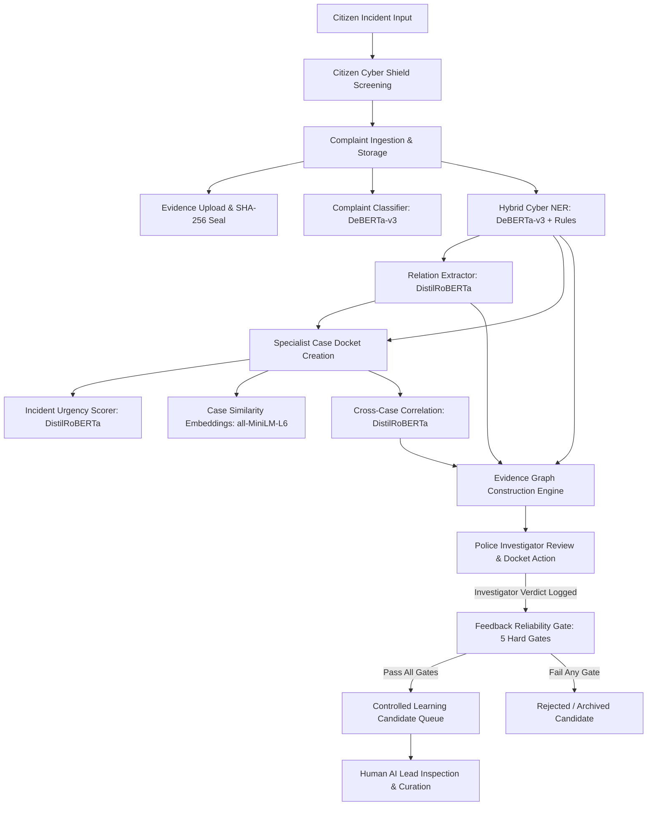

# CCIP / Astraea Enclave — Official Product Architecture

**Document Version:** 1.0.0 (Phase L Baseline)  
**Classification:** Technical Documentation & Patent Evidence  
**Status:** Validated Advanced Prototype / Pilot Preparation  
**System Title:** Citizen Cybercrime Intelligence & Reporting Platform (CCIP) / Astraea Enclave  

---

## 1. Product Title & Purpose

### Title
**Citizen Cybercrime Intelligence & Reporting Platform (CCIP)**, codenamed **Astraea Enclave**.

### Purpose
CCIP is an AI-assisted cybercrime complaint-to-investigation intelligence platform designed to bridge the operational gap between citizen incident reporting, cybersecurity analysis, and law-enforcement investigation. Operating within an offline, sovereign enclave, the platform ingests unstructured citizen reports, extracts technical cyber indicators using a hybrid deterministic-transformer approach, correlates cross-case intelligence, constructs interactive evidence graphs, and enforces a reliability-gated human-in-the-loop learning candidate pipeline—all while maintaining a tamper-evident evidence integrity trail without autonomous law-enforcement decision-making.

---

## 2. Five Authoritative User Roles (RBAC Matrix)

The system strictly enforces role-based access control (RBAC) across five discrete personas:

| Role Identifier | System Scope | Operational Authority | AI / Model Interaction |
|---|---|---|---|
| **`CITIZEN`** | Public Portal & Ingestion | Files complaints, uploads evidence, views personal tracking status, accesses pre-incident Cyber Shield. | Pre-incident threat screening (URL, SMS, Email); no access to investigative models or cases. |
| **`CYBERSECURITY_SPECIALIST`** | Technical Triage | Evaluates technical indicators, extracts cyber entities and relations, activates official case dockets. | Executes Hybrid Cyber NER, Relation Extraction, Incident Urgency scoring; reviews technical findings. |
| **`CYBERCRIME_POLICE`** | Case Command & Investigation | Assigned active case dockets, conducts investigations, updates legal case status, reviews cross-case linkages. | Inspects Evidence Graphs, reviews Cross-Case Correlations, confirms/dismisses candidate links. |
| **`ADMIN`** | Platform Governance | User lifecycle management, administrative overrides, case reopening with mandatory audit justification. | Inspects system health diagnostics, reviews administrative audit logs; no model deployment rights. |
| **`AI_ML_SYSTEM_LEAD`** | MLOps & Model Governance | Model registry oversight, drift monitoring, evaluation of reliability gates, learning candidate curation. | Full access to model cards, performance metrics, and Feedback Gate; strictly read-only on operational cases. |

---

## 3. Application Architecture

```
+-----------------------------------------------------------------------------------+
|                                PRESENTATION TIER                                  |
|  React 18 + TypeScript + Vite + TailwindCSS (Zero Operational Mock Data)          |
|  - Citizen Portal / Cyber Shield    - Specialist Triage Workbench                 |
|  - Police Investigation Command     - Admin Governance Dashboard                  |
|  - AI/ML MLOps Operations Hub       - Interactive Force-Directed Evidence Graph   |
+-----------------------------------------------------------------------------------+
                                         │  HTTPS / JWT Bearer
                                         ▼
+-----------------------------------------------------------------------------------+
|                                 APPLICATION TIER                                  |
|  FastAPI (Python 3.12, Async/Await)                                               |
|  - RBAC Middleware (require_staff, require_admin, require_aiml)                   |
|  - Canonical State Machine (validate_status_transition)                           |
|  - SHA-256 Tamper-Evident Storage Service (Local Enclave Vault)                   |
|  - Intelligence Orchestrator (Fault-isolated multi-stage pipeline)                |
+-----------------------------------------------------------------------------------+
        │                                                     │
        ▼                                                     ▼
+-----------------------------------+   +-------------------------------------------+
|         DATA PERSISTENCE          |   |          LOCAL INTELLIGENCE ENCLAVE       |
|  SQLAlchemy 2.0 (Async)           |   |  100% Offline (local_files_only=True)     |
|  - SQLite (WAL Mode, Prototype)   |   |  - DeBERTa-v3 Token Classifier (NER)      |
|  - Relational Schemas:            |   |  - DeBERTa-v3 Multi-label Classifier      |
|    Complaints, Cases, Entities,   |   |  - DistilRoBERTa Relation Extractor       |
|    Relations, Correlations,       |   |  - DistilRoBERTa Incident Urgency Scorer  |
|    Evidence Graph Nodes/Edges,    |   |  - DistilRoBERTa Cross-Case Correlator    |
|    Learning Candidates, Audit     |   |  - all-MiniLM-L6-v2 Case Embeddings       |
|    Events, Notifications          |   |  - XGBoost URL Phishing Detector          |
|                                   |   |  - MNB / SGD Text Classifiers             |
|                                   |   |  - Deterministic 5-Gate Feedback Filter   |
+-----------------------------------+   +-------------------------------------------+
```

---

## 4. AI/ML Architecture: 11 Local Enclave Models

Every model artifact is hosted locally within `backend/ml_models/` and loaded with `local_files_only=True`. Zero external API calls are made.

| # | Model / Pipeline Name | Base Architecture | Task / Domain | Deterministic vs ML Role |
|---|---|---|---|---|
| 1 | `complaint_classifier` | `deberta-v3-base` (12 layers) | Multi-label Complaint Category Classification (18 labels) | ML: Predicts crime categories with confidence probabilities. |
| 2 | `cyber_ner` (Hybrid Extractor) | `deberta-v3-base` (12 layers) + Regex Rules | Token-level Cyber Entity Extraction (UPI, Bank, Phone, URL, etc.) | **Hybrid:** Regex rules provide deterministic authority; DeBERTa provides contextual augmentation. |
| 3 | `relation_extraction` | `distilroberta-base` (6 layers) | Semantic Relation Inference between extracted entity pairs (9 labels) | ML: Generates candidate relationship type with confidence score. |
| 4 | `incident_urgency` | `distilroberta-base` (6 layers) | Priority Scoring (LOW, MEDIUM, HIGH, CRITICAL) | ML: Assesses severity/urgency; Investigator retains final authority. |
| 5 | `case_similarity` | `all-MiniLM-L6-v2` (6-layer BERT) | Semantic Dense Vector Similarity (384-dim embeddings) | ML: Generates embeddings; Deterministic: Cosine distance calculation. |
| 6 | `cross_case_correlation` | `distilroberta-base` (6 layers) + Entity Overlap | Linkage Detection across historical cases | **Hybrid:** Exact entity matching is deterministic; sequence classifier evaluates narrative resemblance. |
| 7 | `evidence_graph_link` | Deterministic Link Engine | Graph Node/Edge Construction and Candidate Edge Prediction | Deterministic: Constructs graph from verified entities; marks candidate edges as `UNVERIFIED`. |
| 8 | `url_phishing` | XGBoost (30 heuristic features) | URL Lexical & Structural Phishing Screening | ML: Tabular gradient boosting; Deterministic: Feature extraction. |
| 9 | `sms_spam` | Multinomial Naive Bayes + TF-IDF | SMS Smishing Detection | ML: Statistical token probabilities. |
| 10 | `email_threat` | SGD / Linear Classifier + TF-IDF | Email Phishing & Threat Screening | ML: Linear boundary classification. |
| 11 | `feedback_gate` | 5 Deterministic Hard Gates | Data Quality & Drift Governance for Retraining Eligibility | **Deterministic:** Strict programmatic gates (Threshold, PII, Consensus, Anti-Drift). |

---

## 5. Security & Evidence Integrity Architecture

### Tamper-Evident Evidence Integrity Trail
- Every uploaded document or file undergoes immediate server-side computation of its **SHA-256 cryptographic digest**.
- The digest is stored in the database alongside file size, MIME type, uploading user ID, and timestamp.
- On download or review, the file is dynamically re-hashed to verify integrity. Any discrepancy raises an immediate integrity violation.

### Controlled Canonical State Machine
Operational case statuses are strictly governed by `app.core.state_machine.ALLOWED_TRANSITIONS`:
$$\text{DRAFT} \longrightarrow \text{SUBMITTED} \longrightarrow \text{CASE\_CREATED} \longrightarrow \text{UNDER\_INVESTIGATION} \longrightarrow \text{EVIDENCE\_VERIFIED} \longrightarrow \text{LAW\_ENFORCEMENT\_DISPATCHED} \longrightarrow \text{RESOLVED} \longrightarrow \text{CLOSED}$$

- **Terminal State:** `CLOSED` cases cannot be mutated via standard update endpoints.
- **Administrative Override:** Reopening a `CLOSED` case strictly requires `POST /cases/{id}/reopen` by an `ADMIN`, mandating a recorded justification and producing an immutable audit log.

---

## 6. Official End-to-End Operational Pipeline



---

## 7. Division of Technical Authority

To ensure safe, ethical, and legally compliant deployment, the architecture enforces a strict division of authority:

1. **Deterministic Components:**
   - Structured cyber indicators (UPI, phone numbers, email addresses, transaction IDs) extracted via deterministic regular expressions **always supersede** ML token classifications in conflict scenarios.
   - Evidence hashing uses deterministic SHA-256 algorithms.
   - Status transitions are enforced by strict state-machine tables.
   - Governance gating enforces 5 deterministic rejection boundaries.

2. **Machine Learning Components:**
   - Machine learning models provide **advisory assistance only**.
   - Predictions are labeled with explicit UI disclaimers: *"Candidate Correlation — Investigator Review Required"*, *"AI Suggested Entity"*, and *"AI-assisted incident priority"*.
   - No model has the technical capability or permission to trigger automated arrests, freezing of accounts, or dispatching of officers.

3. **Human Authority:**
   - Law-enforcement officers hold sole authority to verify evidence, dispatch field personnel, and mark investigations as resolved or closed.
   - Human correlation reviews are **permanent**: automated intelligence rescans are architecturally prohibited from overwriting an investigator's recorded verdict.
   - AI Leads hold sole authority over the learning candidate queue; automatic model retraining or self-deployment is strictly disabled.
