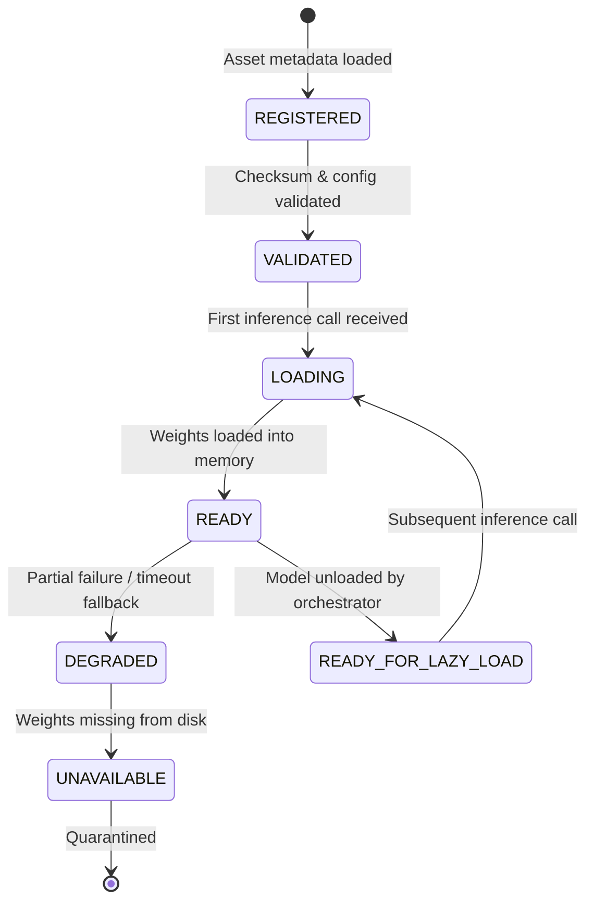

# CCIP AI MODEL INVENTORY & SPECIFICATIONS
## Comprehensive Forensic Audit of All 14 AI/ML Enclave Models
**Platform:** Cyber Crime Intelligence Platform (CCIP)  
**Security Clearance:** ENCLAVE RESTRICTED / AI MLOPS  
**Version:** 2.0.0  
**Registry Root:** `backend/ml_models/`  

---

## 1. Executive Summary

CCIP operates a suite of 14 specialized neural, transformer, and deterministic machine learning models. Every model is governed by the centralized `AIModelOrchestrator` (`backend/app/ai/orchestrator.py`) and `ModelManager` (`backend/app/ai/model_manager.py`), ensuring:
- **Zero-Startup Overhead:** Models are loaded on-demand (lazy-loaded) on first inference request.
- **Dynamic Memory Reclaiming:** Idle models can be safely unloaded via `POST /api/v1/mlops/orchestrator/unload`.
- **Heuristic Fallback Guarantee:** When weights or hardware accelerators are unavailable, rule-based heuristic adapters guarantee uninterrupted platform availability.
- **Human-in-the-Loop Verification:** All AI inference findings are tagged with `human_verification_status = "HUMAN_VERIFICATION_PENDING"`.

---

## 2. 14-Model Inventory Table

| # | Model Identifier | Task Domain | Architecture | Weights Format | Memory Limit | Device | Fallback Mode |
|---|---|---|---|---|---|---|---|
| 1 | `complaint_classifier` | 18-Category Cybercrime Triage | DeBERTa-v2 Sequence Classifier | `model.safetensors` | 450 MB | CPU/CUDA | Keyword rule heuristics |
| 2 | `url_phishing` | Malicious URL & Phishing Detection | Random Forest / XGBoost | `phishing_model.pkl` | 65 MB | CPU | Regex & domain entropy |
| 3 | `sms_spam` | SMS Smishing & Fraud Detection | DistilBERT Sequence Classifier | `model.safetensors` | 260 MB | CPU/CUDA | Smishing pattern regex |
| 4 | `email_threat` | BEC, Spoofing & Phishing Detection | DistilBERT Sequence Classifier | `model.safetensors` | 260 MB | CPU/CUDA | SPF/DKIM header heuristics |
| 5 | `cyber_ner` | Cyber Entity Token Classification | DeBERTa-v2 Token Classifier | `model.safetensors` | 480 MB | CPU/CUDA | Deterministic regex extractor |
| 6 | `case_similarity` | Semantic Narrative Embedding | Sentence-BERT (MiniLM-L6-v2) | `model.safetensors` | 120 MB | CPU/CUDA | TF-IDF / Jaccard similarity |
| 7 | `incident_urgency` | Severity & Financial Risk Triage | DistilRoBERTa Sequence Classifier | `model.safetensors` | 320 MB | CPU/CUDA | Loss amount threshold rules |
| 8 | `relation_extraction` | Entity-to-Entity Relation Mining | DistilRoBERTa Relation Classifier | `model.safetensors` | 320 MB | CPU/CUDA | Co-occurrence heuristic rules |
| 9 | `cross_case_correlation` | Candidate Case Pair Link Scoring | RoBERTa Contextual Classifier | `model.safetensors` | 320 MB | CPU/CUDA | Exact-match indicator intersection |
| 10 | `evidence_graph_link` | Evidence Artifact Link Prediction | PyTorch 80-dim MLP | `evidence_graph_link_model.pt` | 45 MB | CPU | Metadata & hash match linker |
| 11 | `feedback_gate` | Quality Gate for Active Learning | PyTorch 17-dim MLP + Hard Gates | `feedback_gate_model.pt` | 25 MB | CPU | Uncertainty margin threshold |
| 12 | `graph_correlation` | Subgraph Cluster Topology Scoring | NetworkX / Topological Linker | `metadata.json` + Python | 35 MB | CPU | Degree centrality & path distance |
| 13 | `investigation_assistant` | RAG Conversational Assistant | Astraea Sovereign Forensic SOP Engine | Grounded Knowledge Embeddings | 150 MB | CPU | Admin-approved RAG knowledge search |
| 14 | `risk_scoring` | Composite Case Risk Score (0–100) | Weighted Ensemble Scoring Matrix | `metadata.json` + Python | 20 MB | CPU | Deterministic risk matrix |

---

## 3. Lifecycle State Machine

Every model transitions across explicit states:

1. `REGISTERED`: Asset folder and configuration registered in `ModelManager`.
2. `VALIDATED`: Integrity of model configuration, labels, and tokenizers verified.
3. `LOADING`: Background thread is actively deserializing weights into RAM/VRAM.
4. `READY`: Model is fully resident in cache and ready for sub-second inference.
5. `DEGRADED`: Fallback heuristic adapter is answering queries due to timeout or GPU pressure.
6. `UNAVAILABLE`: Weights are absent or corrupted.
7. `DISABLED`: Administratively deactivated in Model Registry.

