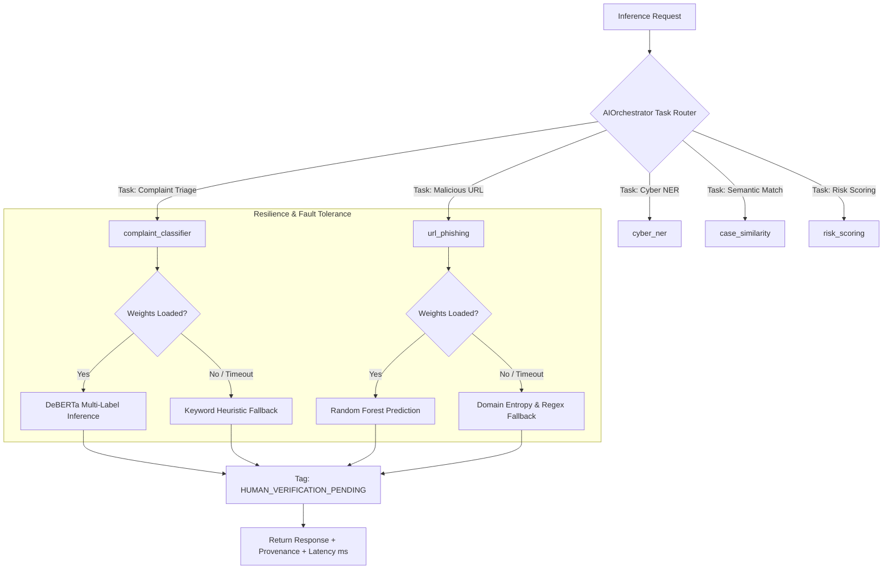

# CENTRALIZED AI MODEL ORCHESTRATION ARCHITECTURE
## Sovereign AI/ML Orchestration, Task Routing, Fallbacks & Telemetry
**Platform:** Cyber Crime Intelligence Platform (CCIP)  
**Security Clearance:** ENCLAVE RESTRICTED / AI MLOPS  
**Version:** 2.0.0  

---

## 1. Architectural Blueprint

The CCIP `AIOrchestrator` (`backend/app/ai/orchestrator.py`) provides an abstraction layer between high-level operational modules (Citizen Intake, Law Enforcement Workspace, Correlation Engine) and underlying neural weights.



---

## 2. API Contract & Task Endpoints

- **Live Telemetry:** `GET /api/v1/mlops/orchestrator/status` returns operational state, total registered models (14), active cache count, and device framework details.
- **Resource Reclaim:** `POST /api/v1/mlops/orchestrator/unload?model_name={name}` permits authorized AI Leads (`AI_ML_SYSTEM_LEAD`) to unload idle models from RAM.
- **Human Verification Requirement:** Under no circumstances may AI output be directly transformed into criminal convictions or case closures. Every output explicitly includes:
  ```json
  {
    "is_cybercrime": true,
    "primary_category": "Financial Fraud",
    "confidence_scores": { "Financial Fraud": 0.94 },
    "inference_latency_ms": 78.4,
    "human_verification_status": "HUMAN_VERIFICATION_PENDING"
  }
  ```

