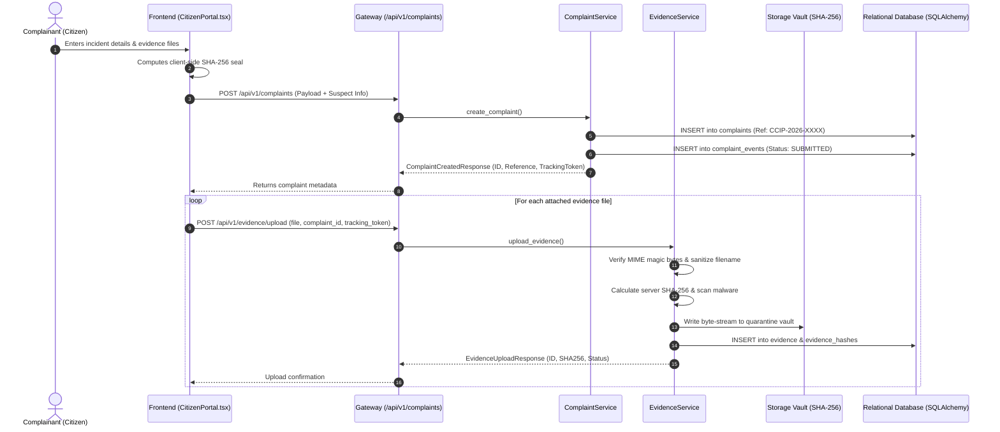
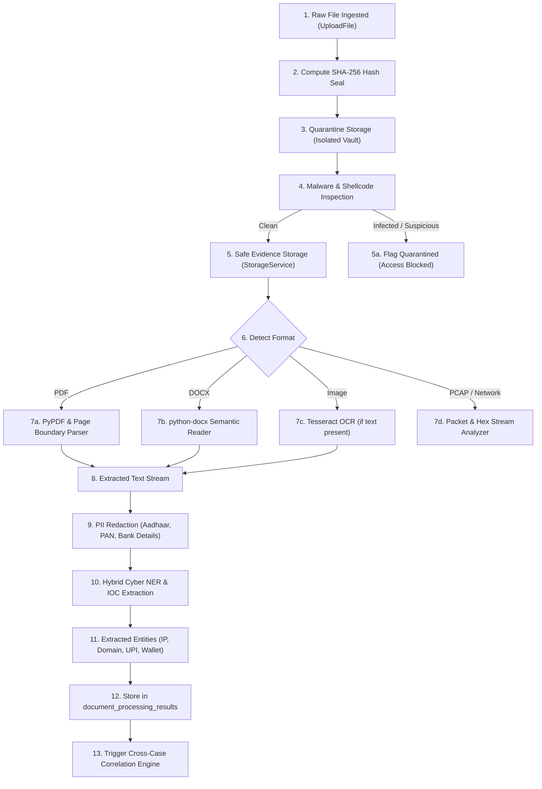
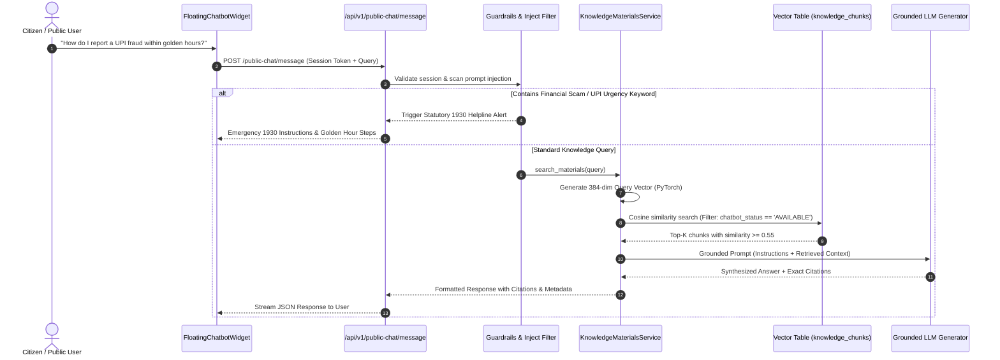

# CCIP – Data Flow & Telemetry Architecture
## Complete Data Lifecycle, Investigation Pipelines & Cryptographic Flow

---

### 1. Citizen Incident Reporting & Intake Pipeline

---

### 2. Digital Evidence Processing & Forensic Analysis Pipeline

---

### 3. Sovereign RAG Knowledge Retrieval Pipeline

---

### 4. Cross-Case Correlation & Graph Resolution Pipeline

1. **Indicator Ingestion:** Extracted IOCs (suspect bank account, phone number, UPI handle, IP address, cryptocurrency address) are committed to the `cyber_entities` registry.
2. **Cluster Matching:** `cross_case_correlation_service.py` evaluates indicator co-occurrence across open complaints and formal police cases.
3. **Weight Computation:** Jaccard similarity and graph adjacency metrics score the likelihood that separate complaints represent the same syndicated cybercrime syndicate.
4. **Graph Persistence:** Generated correlations are persisted in `case_correlations` and rendered dynamically in the 3D WebGL correlation graph (`react-force-graph-3d`).
