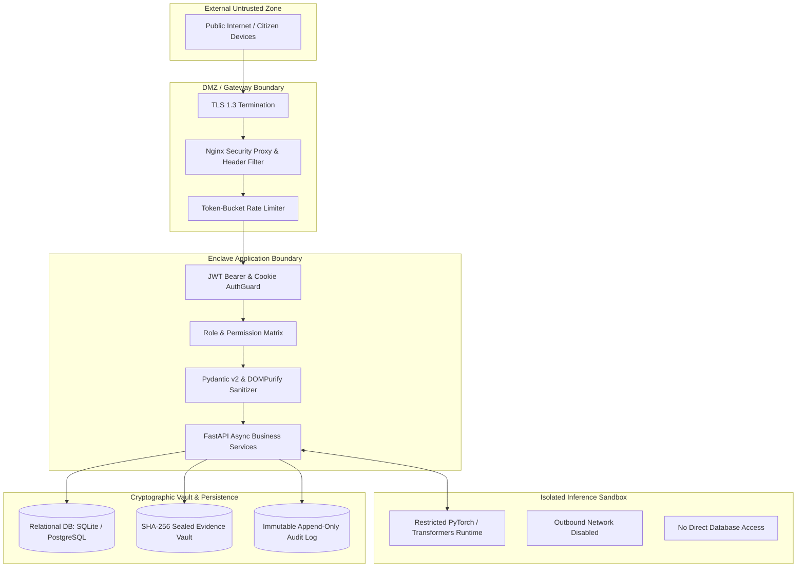

# CCIP – Security Architecture & Defense-in-Depth Specification
## Zero-Trust Cryptographic Enforcement, Sovereign Enclave Isolation & RBAC Blueprint

---

### 1. Zero-Trust Security Principles

1. **Explicit Verification:** Every API call is authenticated and authorized; no network perimeter or client-side assumption is trusted.
2. **Least Privilege Enforcement:** Users and internal services operate with the minimal permissions required to complete specific operational tasks.
3. **Assume Breach:** Sensitive evidence files and cryptographic hashes are stored independently from public-facing RAG indexes.
4. **Data Minimization:** Citizen identity and payment indicators are scrubbed using automated PII redactors prior to semantic indexing.

---

### 2. Authentication & Credential Architecture

- **Password Hashing:** Argon2id via `argon2-cffi` ($t=3, m=65536\text{ KiB}, p=4$). Salt length 16 bytes, key length 32 bytes.
- **Access Tokens:** Signed RS256/HS256 JSON Web Tokens with 30-minute expiration.
- **Refresh Tokens:** Cryptographically random 64-character tokens stored hashed in `refresh_tokens`. Rotated upon single use.
- **OAuth 2.0 Integration:** Google OpenID Connect exchange with state verification and audience validation.
- **Session Revocation:** Centralized blacklist and database flag invalidating active tokens upon password changes or administrative deactivation.

---

### 3. Role-Based Access Control (RBAC) Matrix

| Permission Code | Citizen | Specialist (SOC) | Cybercrime Police | Admin | AI/ML Lead |
| :--- | :---: | :---: | :---: | :---: | :---: |
| `complaint.create` | ✅ | ✅ | ✅ | ✅ | ❌ |
| `complaint.read_own` | ✅ | ✅ | ✅ | ✅ | ❌ |
| `complaint.read_all` | ❌ | ✅ | ✅ | ✅ | ❌ |
| `evidence.upload` | ✅ (Own) | ✅ | ✅ | ✅ | ❌ |
| `evidence.read` | ✅ (Own) | ✅ | ✅ | ✅ | ❌ |
| `cases.manage` | ❌ | ✅ | ✅ | ✅ | ❌ |
| `intelligence.view` | ❌ | ✅ | ✅ | ✅ | ✅ |
| `models.manage` | ❌ | ❌ | ❌ | ❌ | ✅ |
| `models.rollback` | ❌ | ❌ | ❌ | ❌ | ✅ |
| `knowledge.manage` | ❌ | ❌ | ❌ | ✅ | ❌ |
| `users.manage` | ❌ | ❌ | ❌ | ✅ | ❌ |
| `audit.read` | ❌ | ❌ | ✅ | ✅ | ❌ |

---

### 4. Digital Evidence Cryptographic Sealing

1. **SHA-256 Integrity Verification:**
   - Every evidence file ingested generates a SHA-256 digest on upload.
   - The digest is registered in the immutable `evidence_hashes` table with timestamp and uploader ID.
   - Any modification or byte alteration flags the file as `INTEGRITY_COMPROMISED`.
2. **Chain-of-Custody Logging:**
   - Access, download, export, and analysis events write to `evidence_access_logs`.
   - The original evidence byte stream is write-once, read-many (WORM). Derived forensic results (OCR text, extracted metadata) are saved in companion tables.

---

### 5. Regulatory Compliance Mappings

- **DPDP Act 2023 (India):** Automated PII redaction of Aadhaar, PAN, and bank accounts in `pii_redactor.py`. Ephemeral storage for public chatbot inquiries.
- **CERT-In Cyber Security Directions:** Mandatory logging of system access and security incidents; NTP-synchronized timestamps.
- **GIGW 3.0 Guidelines:** Accessibility compliance, glassmorphic visual hierarchy, responsive interfaces across mobile and desktop.
