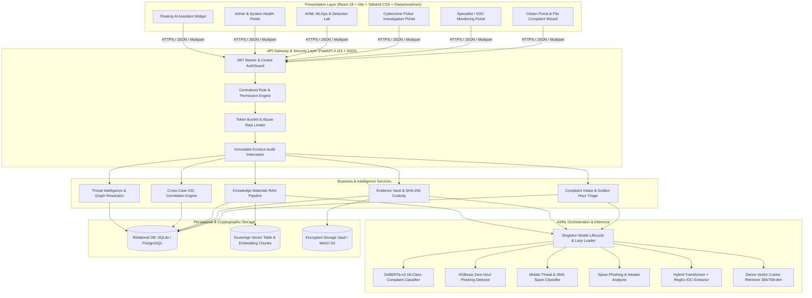

# CCIP – Cyber Crime Intelligence Platform
## Complete System Architecture & Engineering Blueprint

---

### Executive Overview

The **Citizen Cybercrime Intelligence Platform (CCIP)** is a defense-grade cybercrime investigation, forensic evidence management, cross-case correlation, threat intelligence analysis, and AI-assisted triage platform. 

It is engineered as a zero-trust multi-portal ecosystem serving five primary user groups:
1. **Citizens:** Anonymous or authenticated complainants lodging cyber fraud reports, providing evidence, tracking investigation milestones, and interacting with the 24/7 RAG AI Assistant.
2. **Cybersecurity Specialists (SOC):** Analysts performing technical triage, IOC extraction, IP/domain/URL reputation analysis, and payload detonation analysis.
3. **Cybercrime Police Command:** Law enforcement officers conducting formal investigations, chain-of-custody tracking, judicial evidence sealing, and court-admissible reporting.
4. **AI/ML System Leads:** Engineers maintaining models, monitoring data drift, managing Continual Learning pipelines, and approving model retraining checkpoints.
5. **System Administrators:** Security operations officers governing access, audit logs, system telemetry, and sovereign knowledge materials RAG ingestion.

---

### Logical Layer Decomposition

#### 1. Presentation Layer
- **Framework:** React 18.3.1 with TypeScript 5.7, bundled via Vite 6.0.
- **Styling:** Custom Glassmorphism design system (`#030d08` dark palette, `#00e676` neon cyber-green accents, backdrop blurs, glow shadows).
- **Visualization:** `react-force-graph-3d` and `Three.js` for 3D cross-case correlation graphs, `recharts` for telemetry charts, `lucide-react` for iconography.
- **Portals:**
  - `LandingPage.tsx`: Public emergency interface with 1930 Helpline integration and sovereign chatbot launcher.
  - `CitizenPortal.tsx`: Complaint intake, tracking timeline, documents vault, cyber awareness guides.
  - `SpecialistPortal.tsx`: SOC threat monitoring, quick triage queue, live payload analyzer.
  - `InvestigationWorkspacePortalView.tsx`: Deep-dive investigation dossier with IOC tags and chain of custody.
  - `CrossCaseCorrelationPortalView.tsx`: 3D node-link cluster visualization of shared suspect wallets, IPs, and phone numbers.
  - `AIMLDetectionLabView.tsx`: Live batch testing and zero-hour evaluation of cyber threats.
  - `AdminPortal.tsx`: User governance, system configuration, audit logs, and knowledge materials RAG management.

#### 2. Authentication & Authorization Layer
- **Authentication:** Dual-mode authentication supporting:
  - Standard email/password with Argon2id password hashing.
  - Google OAuth2 token exchange and account linking.
  - High-entropy signed session tokens for anonymous citizen reporting.
  - Ephemeral public chat session tokens with 24-hour time-to-live (TTL).
- **Authorization (RBAC):** Hierarchical role assignment (`CITIZEN`, `CYBERSECURITY_SPECIALIST`, `CYBERCRIME_POLICE`, `ADMIN`, `AI_ML_SYSTEM_LEAD`).
- **Resource Ownership:** Enforcement that citizens can access only their own cases, while investigation staff access cases based on departmental assignment.

#### 3. API Gateway & Routing Layer
- **Framework:** FastAPI running on Uvicorn ASGI server with non-blocking async routes.
- **API Versioning:** Structured under `/api/v1/*`.
- **Global Error Handling:** Custom exceptions mapped to standard RFC-7807 problem details with unique request IDs.
- **Request Validation:** Pydantic v2 schemas validating request bodies, query parameters, and form payloads.

#### 4. Business Logic & Investigation Layer
- **Golden Hours Incident Processing:** Prioritizes financial cyber fraud reported within 2–4 hours of occurrence for instant bank freeze advisory.
- **Evidence Management:** Computes SHA-256 submission integrity seal upon upload, quarantine virus check, and generates derived forensic artifacts without altering original raw bytes.
- **Cross-Case Correlation:** Uncovers syndicated cybercrime gangs by linking disconnected complaints that share financial bank accounts, UPI IDs, suspect domains, or Telegram handles.

#### 5. AI Orchestration & RAG Layer
- **Lifecycle Management:** `ModelManager` singleton providing thread-safe lazy loading and memory pooling.
- **Sovereign RAG Pipeline:**
  - Ingestion: Extracts text from PDF, DOCX, TXT via PyMuPDF/python-docx.
  - Chunking: Semantic boundary chunker (500 tokens, 75 overlap).
  - Embeddings: Local dense embeddings using PyTorch.
  - Vector Retrieval: Cosine similarity vector matching with metadata filtering (`chatbot_status == 'AVAILABLE'`).
  - Guardrails: Prompt injection sanitation, PII redactor (DPDP Act 2023), and 1930 Helpline statutory response triggers.

#### 6. Persistence & Storage Layer
- **Database:** SQLAlchemy 2.0 with asynchronous drivers (`aiosqlite` for sovereign local enclave, `asyncpg` for enterprise PostgreSQL).
- **File Storage:** Abstraction layer (`storage_service.py`) supporting local cryptographic storage vault with SHA-256 verification and MinIO S3 enterprise object storage.
- **Audit Ledger:** Append-only audit table logging user identity, IP address, user-agent, action code, resource ID, and tamper-resistant timestamps.

---

### Communication & Security Boundaries

1. **Client to Server:** Strict TLS 1.3 encryption. JWT Bearer headers for APIs, secure HttpOnly cookies for web sessions.
2. **AI Model Boundary:** AI models run in an isolated execution sandbox and cannot make direct network calls or execute arbitrary SQL queries.
3. **Data Segregation:** Public citizen RAG queries can retrieve only documents explicitly approved by administrators in the `knowledge_materials` table. Internal police case evidence is completely isolated from the public chatbot vector space.

