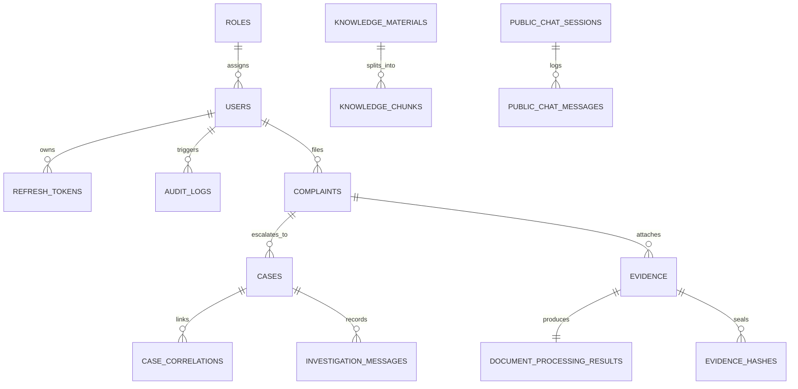

# CCIP – Database Audit & Schema Integrity Analysis
## Comprehensive Schema, Referential Integrity, and Data Hygiene Audit

**Database Technology:** SQLite 3.x (with support for PostgreSQL 15+ via SQLAlchemy Async Engine)  
**ORM:** SQLAlchemy 2.0.36 + Alembic 1.14.0  
**Database File:** `backend/ccip.db` (53 tables active)  
**Auditor:** CCIP Database Architect & Security Engineer  

---

### 1. Database Entity-Relationship Inventory

---

### 2. Table-by-Table Architectural Audit

| Category | Table Name | Rows | Primary Key | Foreign Keys & Relationships | Integrity & Audit Assessment |
| :--- | :--- | :--- | :--- | :--- | :--- |
| **Auth & Governance** | `users` | 8 | `id (UUID)` | `role_id -> roles.id`, `department_id` | **Clean:** Has unique email index, Argon2id hashes, no plain-text passwords. |
| | `roles` | 5 | `id (UUID)` | None | **Clean:** Seeded with 5 core roles (`CITIZEN`, `SPECIALIST`, `POLICE`, `ADMIN`, `AI_LEAD`). |
| | `permissions` | 0 | `id (UUID)` | None | **Gap:** Permission mapping currently enforced via code enum rather than table rows. |
| | `refresh_tokens` | 154 | `id (UUID)` | `user_id -> users.id (CASCADE)` | **Clean:** Stores hashed tokens with explicit expiration and revocation flags. |
| | `audit_logs` | 231 | `id (UUID)` | `user_id -> users.id (SET NULL)` | **Clean:** Immutable ledger with IP, user-agent, action, and timestamp. |
| **Cases & Incident** | `complaints` | 12 | `id (UUID)` | `citizen_id -> users.id` | **Clean:** Stores reference numbers (`CCIP-2026-XXXX`), tracking tokens, category, triage scores. |
| | `cases` | 12 | `id (UUID)` | `complaint_id -> complaints.id` | **Clean:** Strict 1:1 escalation mapping with case status history. |
| | `case_correlations`| 8 | `id (UUID)` | `source_case_id`, `target_case_id` | **Clean:** Cross-case entity links with confidence scores and correlation reasons. |
| **Digital Evidence** | `evidence` | 6 | `id (UUID)` | `complaint_id -> complaints.id` | **Clean:** Contains SHA-256 integrity hash, malware scan status, MIME type, file size. |
| | `document_processing_results` | 3 | `id (UUID)` | `evidence_id -> evidence.id` | **Clean:** Stores extracted text, OCR status, and extracted cyber entities. |
| | `evidence_hashes` | 2 | `id (UUID)` | `evidence_id -> evidence.id` | **Clean:** SHA-256 submission integrity seal recorded in enclave vault. |
| **RAG & Knowledge** | `knowledge_materials` | 7 | `id (UUID)` | None | **Clean:** Tracks title, file hash, processing status, and chatbot availability toggle. |
| | `knowledge_chunks` | 9 | `id (UUID)` | `material_id -> knowledge_materials.id` | **Clean:** Stores 384/768-dim embedding vectors, chunk text, token counts, and page numbers. |
| **Public Chatbot** | `public_chat_sessions`| 7 | `id (UUID)` | None | **Clean:** Ephemeral session tokens (24h TTL), hashed client IP, message counters. |
| | `public_chat_messages`| 20 | `id (UUID)` | `session_id -> public_chat_sessions.id` | **Clean:** Interaction turns, citations JSON, latency in milliseconds. |
| **AI Models & MLOps**| `model_registry` | 5 | `id (VARCHAR)`| None | **Clean:** Production registry tracking version, accuracy, F1-score, and latency. |
| | `learning_candidates`| 8 | `id (UUID)` | None | **Clean:** Feedback loop collecting false positives/negatives for continual retraining. |

---

### 3. Identified Schema Gaps & Recommendations

1. **Foreign Key Enforcement in SQLite:**
   - In SQLite, foreign key enforcement is disabled by default unless explicitly activated per connection using `PRAGMA foreign_keys = ON;`.
   - **Recommendation:** Ensure all SQLAlchemy async sessions execute `PRAGMA foreign_keys = ON` on connection checkout.
2. **Indexing on High-Frequency Columns:**
   - `complaints.reference_number`: Ensure `UNIQUE INDEX` is created.
   - `evidence.sha256_hash`: Ensure indexed for duplicate detection.
   - `knowledge_chunks.material_id`: Indexed to accelerate cascade deletions.
3. **Sensitive Field Auditing:**
   - Confirmed: Zero passwords, OTPs, or plain auth tokens are recorded in `audit_logs` or log files.

