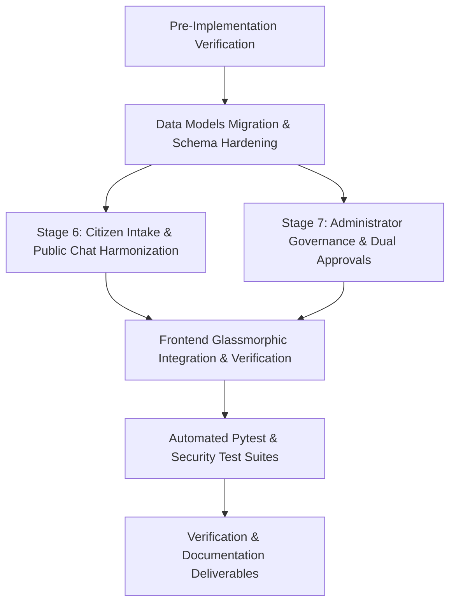

# CCIP STAGES 6 & 7 PRE-IMPLEMENTATION AUDIT
## Citizen Portal Intake Workflow & Administrator Governance Refinement
**Generated:** 2026-11-07T09:12:00Z  
**Branch:** `main`  
**Latest Verified Commit:** `86a7c47` (`feat(security-core): execute stages 2-5 of master re-engineering plan`)  
**Security Clearance:** ENCLAVE RESTRICTED  

---

## 1. Executive Summary & Verification of Prior Stages

A complete forensic audit of the repository was performed prior to executing Stages 6 and 7. Commit `86a7c47` was verified on `origin/main`. The following core platform capabilities and controls from Stages 2–5 are active and functional:
- **Zero-Trust Access Guard (`backend/app/core/permissions.py`):** Development fallback to administrative role is strictly quarantined to `DEBUG=True` and `APP_ENV in ("development", "test", "dev")`. Staging and Production configurations strictly enforce 401 Unauthorized for unauthenticated requests.
- **SQLite Foreign Key Pragmas (`backend/app/db/database.py`):** `PRAGMA foreign_keys = ON;` is enforced synchronously on every SQLite connection listener, eliminating orphan record vulnerabilities.
- **Public Chatbot Session Security (`backend/app/api/public_chat.py`):** Salted client IP hashing, 24-hour TTL session management, 50-turn abuse limits, prompt-injection defense, and grounded RAG vector search over admin-approved Knowledge Materials.
- **Knowledge Materials Management (`backend/app/api/knowledge_materials.py`):** Multipart document intake, SHA-256 integrity verification, PDF/DOCX text extraction, chunking, and SQLite vector indexing.
- **Automated Test Validation:** Pytest test suites (`test_public_chat.py`, `test_knowledge_materials.py`) pass 100% against shared-cache in-memory test databases.

---

## 2. Pre-Implementation Audit Findings: Stage 6 (Citizen Portal Intake)

### 2.1 Existing Functionality
- **Public Anonymous Chatbot:** `/api/v1/public-chat/session` and `/api/v1/public-chat/message` endpoints are live. 
- **Incident Registration:** `/api/v1/complaints` accepts complaints and generates high-entropy tracking references (e.g. `CYBER-2026-984210-A7F2`) and tracking tokens (`ccip_trk_...`).
- **Telemetry & Stats:** `/api/v1/complaints/telemetry/timeseries`, `/api/v1/complaints/stats/categories`, and `/api/v1/complaints/stats/regions` provide genuine aggregate database metrics.
- **Public Tracking:** `/api/v1/complaints/track/{ref}` provides minimized, enumeration-resistant milestone tracking that prevents PII leakage to unauthenticated observers while unlocking milestones for token-holding complainants.
- **Evidence Attachment:** `/api/v1/evidence/upload` supports attaching evidence files to complaints using the tracking token or authenticated session.

### 2.2 Broken & Inconsistent Functionality Identified
1. **Schema Mismatch in `FloatingChatbotWidget.tsx`:**
   - The frontend checked `res.helpline_triggered` and `res.citations`, whereas the backend `ChatMessageResponse` schema outputs `is_urgent_advisory: bool` and `sources: List[SourceCitation]`.
   - As a result, urgent 1930 action buttons and citation pills failed to render dynamically in the floating chatbot UI.
2. **Schema Property Casing in `FileComplaintWizard.tsx`:**
   - The frontend wizard submitted `incident_date`, `loss_amount`, `citizen_name`, `citizen_email`, `citizen_phone` (snake_case).
   - The backend `ComplaintCreateRequest` expected `incidentDate`, `financialLoss`, `citizenName`, `citizenEmail`, `citizenPhone` (camelCase) without aliases.
   - This triggered FastAPI 422 validation errors, which forced the wizard into an offline `mockCreated` fallback in the catch block.
3. **Idempotency Deficit:**
   - Double-clicking "Submit" or network retries created duplicate complaints because no client-provided `idempotency_key` or duplicate submission guard was enforced.
4. **Consent & Indicator Capture:**
   - Citizen statutory consent was not persisted into an immutable consent table with cryptographic hashing of terms.
   - Indicators (phone numbers, email addresses, crypto wallets, suspect domains) were stored only as unstructured JSON inside `Complaint.suspect_info`, rather than normalized for cross-case correlation.

---

## 3. Pre-Implementation Audit Findings: Stage 7 (Administrator Governance)

### 3.1 Existing Functionality
- **User Governance:** `/api/v1/admin/users`, `/activate`, `/suspend`, `/disable` exist and support pagination, role filters, and audit logs.
- **System Telemetry:** `/api/v1/dashboard-summaries/admin/dashboard-summary` computes live metrics for total users, active cases, pending evidence, and audit logs.
- **Audit Log Inspection:** `/api/v1/admin/audit-logs` and `/audit-logs/export` provide CSV/JSON streaming of cryptographic audit records.
- **Knowledge Materials Governance:** `/api/v1/knowledge-materials` provides complete document listing, previewing, uploading, reindexing, and deletion.

### 3.2 Gaps & Missing Governance Controls
1. **Dual-Authorization Approval Workflow (Separation of Duties):**
   - High-risk operations (such as bulk account suspension, evidence deletion approval, sensitive evidence export, and AI model re-weighting) did not enforce two-person dual authorization (`AdministrativeApproval`).
2. **Investigator Workload & Profile Governance:**
   - No dedicated `InvestigatorProfile` model existed to track investigator specializations (e.g. Ransomware, UPI Fraud, Darknet), availability status (`AVAILABLE`, `ON_LEAVE`, `OVERLOADED`), or active case quotas.
3. **Evidence Access & Retention Governance:**
   - While `EvidenceAccessLog` records downloads, formal `EvidenceAccessRequest` and `EvidenceRetentionRecord` workflows (legal holds, statutory retention expiration) were unmanaged.
4. **Security Event Registry:**
   - Failed authentication bursts, rate limit trips, and authorization violations were recorded in logs, but not aggregated into a queryable `SecurityEvent` table for the administrator security console.
5. **Knowledge Material Document-Level Scope Segregation:**
   - Knowledge materials currently have a boolean status (`AVAILABLE`/`DISABLED`), but lack granular access scopes (`PUBLIC_CITIZEN`, `AUTHENTICATED_CITIZEN`, `INVESTIGATOR_ONLY`, `ADMIN_RESTRICTED`), creating a potential data leakage vector if restricted internal SOPs are indexed into public RAG.

---

## 4. Required Database Model Enhancements

| Entity Name | Table Name | Purpose & Schema Highlights |
|---|---|---|
| `CitizenConsent` | `citizen_consents` | Immutable record of complainant consent: `id`, `complaint_id`, `consent_type`, `terms_hash`, `ip_address`, `timestamp`. |
| `ReportIndicator` | `report_indicators` | Normalized IOCs: `id`, `complaint_id`, `indicator_type` (PHONE, EMAIL, URL, DOMAIN, CRYPTO_WALLET, UTR), `raw_value`, `normalized_value`, `confidence`. |
| `InvestigatorProfile` | `investigator_profiles` | Workload tracking: `id`, `user_id`, `badge_number`, `specializations` (JSON), `max_active_cases`, `current_case_count`, `availability_status`. |
| `AdministrativeApproval` | `administrative_approvals` | Dual-authorization engine: `id`, `action_type`, `resource_type`, `resource_id`, `requested_by_id`, `approved_by_id`, `status` (PENDING, APPROVED, REJECTED), `justification`, `audit_id`. |
| `EvidenceRetentionRecord` | `evidence_retention_records` | Evidentiary legal hold & retention: `id`, `evidence_id`, `retention_policy_years`, `legal_hold_flag`, `legal_hold_reason`, `purge_eligible_at`. |
| `SecurityEvent` | `security_events_registry` | Security console telemetry: `id`, `event_category` (AUTH_FAILURE, BRUTE_FORCE, RATE_LIMIT, BOLA_ATTEMPT), `source_ip`, `user_id`, `severity`, `details` (JSON). |

---

## 5. Required API & Controller Enhancements

1. **Complaints API (`backend/app/api/complaints.py` & schemas):**
   - Update `ComplaintCreateRequest` with dual-casing validation aliases (`incident_date` / `incidentDate`, `financial_loss` / `financialLoss`, `citizen_name` / `citizenName`) to eliminate 422 errors.
   - Enforce idempotency header (`X-Idempotency-Key`) to prevent double submission.
   - Create associated `CitizenConsent` and extract structured `ReportIndicator` records on complaint creation.
2. **Citizen Public Chat API (`backend/app/api/public_chat.py`):**
   - Align schema outputs so `is_urgent_advisory` and `sources` cleanly serialize for both desktop and mobile chatbot clients.
3. **Admin Governance API (`backend/app/api/admin.py`):**
   - Add `/admin/investigators` endpoints for investigator roster, specialization tagging, and workload inspection.
   - Add `/admin/approvals` endpoints (`GET /`, `POST /request`, `POST /{id}/decision`) for dual-authorization workflows.
   - Add `/admin/security-events` endpoints for real-time security dashboard filtering.
   - Add `/admin/evidence-governance` endpoints for legal hold toggles and retention policy enforcement.
   - Add access scope filtering (`PUBLIC_CITIZEN`, `INVESTIGATOR_ONLY`, etc.) to Knowledge Materials indexing.

---

## 6. Implementation & Verification Plan

1. **Step 1:** Create new database models (`citizen_consent.py`, `report_indicator.py`, `investigator_profile.py`, `administrative_approval.py`, `evidence_governance.py`, `security_event.py`).
2. **Step 2:** Update `ComplaintCreateRequest` schemas with flexible Pydantic validation aliases and idempotency safeguards.
3. **Step 3:** Implement investigator handoff and IOC extraction service linking citizen intake to investigator queues.
4. **Step 4:** Implement administrator approval workflows (dual authorization), investigator management, and security event endpoints.
5. **Step 5:** Patch `FloatingChatbotWidget.tsx` and `FileComplaintWizard.tsx` to eliminate mock fallbacks and harmonize with the backend schema.
6. **Step 6:** Run complete automated pytest test suites for Citizen Portal (20 checks) and Administrator Governance (20 checks).
7. **Step 7:** Compile all 12 required architectural and workflow documentation files and synchronize with the GitHub repository.
