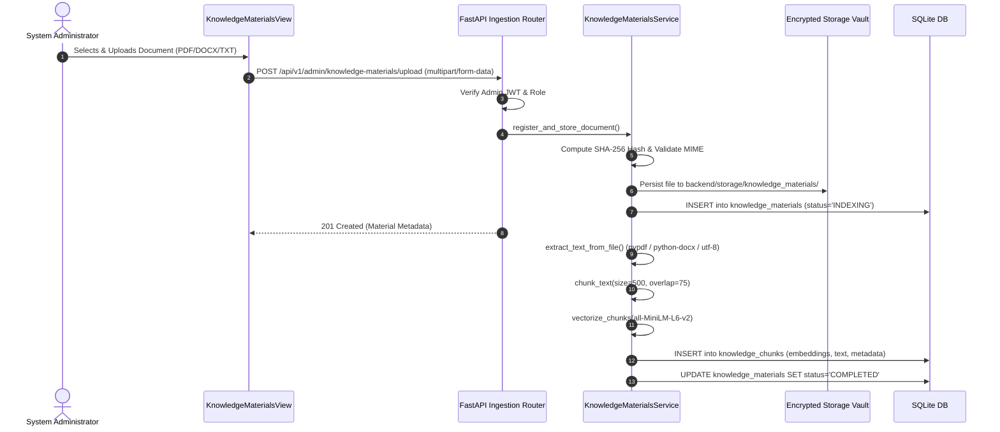
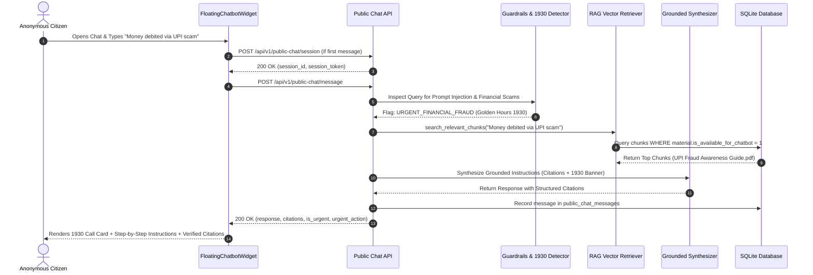

# CCIP AI Assistant & Knowledge Materials: System Architecture

**Document ID:** CCIP-DOC-CB-002  
**Version:** 1.0.0 (Production)  
**Status:** Implemented & Verified  
**Classification:** Sovereign Tier — Cybercrime Intelligence Platform  

---

## 1. Executive System Overview

The **CCIP AI Assistant (Chatbot)** and its backing **Knowledge Materials Management System** deliver a grounded, low-latency, and privacy-preserving public assistance capability for Indian citizens seeking cybercrime remediation, advisory, and reporting guidance. 

The architecture is built upon a fundamental security tenet: **Complete Sovereign Enclave Airgapping**. Anonymous public citizens interacting with the floating chatbot on the CCIP landing page have access **strictly** to approved public cybercrime knowledge materials. Under no circumstances can public RAG queries intersect, retrieve, or infer data from internal police case files, active FIR dockets, suspect indicators of compromise (IOCs), or confidential digital evidence.

```
+---------------------------------------------------------------------------------------------------+
|                                        PUBLIC WEB LAYER                                           |
|  +--------------------------------+                  +-----------------------------------------+  |
|  |   CCIP Landing Page            |                  |   Floating Chatbot Widget               |  |
|  |   (Public Complainant Portal)  |                  |   (Anonymous, No Login, Emerald Theme)  |  |
|  +--------------------------------+                  +-----------------------------------------+  |
+---------------------------------------------------|-----------------------------------------------+
                                                    | REST API (Session & Streamed / JSON Chat)
                                                    v
+---------------------------------------------------------------------------------------------------+
|                                 APPLICATION GATEWAY (FASTAPI)                                     |
|  +-----------------------------------------+      +--------------------------------------------+  |
|  | Public Chat Controller                  |      | Knowledge Materials Controller             |  |
|  | `/api/v1/public-chat/*`                 |      | `/api/v1/admin/knowledge-materials/*`      |  |
|  | - Anonymous Signed Token Guard          |      | - Strict Role Enforcement (System Admin)   |  |
|  | - Sliding Window IP Rate Limiter        |      | - Audit Logging & Action Telemetry         |  |
|  | - 1930 Golden Hours Urgent Interception |      | - Document Upload, Preview, Toggle, Delete |  |
|  +-----------------------------------------+      +--------------------------------------------+  |
+-----------------------------------|--------------------------------|------------------------------+
                                    |                                |
                                    v                                v
+---------------------------------------------------------------------------------------------------+
|                                      CORE DOMAIN SERVICES                                         |
|  +---------------------------------------------------------------------------------------------+  |
|  | Knowledge Materials & Ingestion Service (`knowledge_materials_service.py`)                   |  |
|  | - SHA-256 Deduplication & MIME Validation (PDF, DOCX, TXT)                                  |  |
|  | - Ingestion Pipeline: Text Extraction -> Chunking (500 Tok / 75 Overlap) -> Embeddings       |  |
|  | - Vector Semantic Search: Cosine Similarity with Dense 384-dim Embeddings                   |  |
|  | - LLM Synthesizer & Strict Citation Attribution Engine                                       |  |
|  +---------------------------------------------------------------------------------------------+  |
|  | Prompt Security & Guardrails Engine                                                         |  |
|  | - Defensive Persona System Prompt                                                           |  |
|  | - Prompt Injection, Jailbreak, and Boundary Refusal Sanitizer                              |  |
|  +---------------------------------------------------------------------------------------------+  |
+-----------------------------------|--------------------------------|------------------------------+
                                    |                                |
                                    v                                v
+---------------------------------------------------------------------------------------------------+
|                                  PERSISTENCE & STORAGE TIER                                       |
|  +-----------------------------------+             +-------------------------------------------+  |
|  | SQLite Sovereign Database         |             | Private Sovereign File Vault              |  |
|  | - `knowledge_materials`           |             | Path: `backend/storage/knowledge_materials`|  |
|  | - `knowledge_chunks` (Vector Blobs)|            | - Non-public, isolated server directory    |  |
|  | - `public_chat_sessions` (24h TTL)|             | - Files named by UUID & sanitized title   |  |
|  | - `public_chat_messages`          |             +-------------------------------------------+  |
|  +-----------------------------------+                                                            |
+---------------------------------------------------------------------------------------------------+
```

---

## 2. Layered Architectural Decomposition

### 2.1 Public Frontend Presentation Tier
- **Framework:** React 19 with Vite 6 and Tailwind CSS.
- **Entry Points:**
  - `FloatingChatbotWidget.tsx`: Floating interactive widget positioned at the bottom-right of the public landing page (`z-index: 50`). Supports minimized/expanded states, quick suggestion pills, verified knowledge citation tags, and the high-priority **Dial 1930 Helpline** action card.
  - `KnowledgeMaterialsView.tsx`: Embedded in the Admin Portal for System Administrators. Presents three live summary statistic cards (`Total Materials`, `Storage Used`, `Available for Chatbot`), document table with sorting/filtering, modal preview with chunk browser, and drag-and-drop document uploader.

### 2.2 API Gateway & Security Perimeter
- **Framework:** FastAPI running on Python 3.12 with asynchronous event handling.
- **Session Security:** Anonymous sessions are granted via `POST /api/v1/public-chat/session`. The response yields a cryptographically signed HMAC token (`session_token`) bound to the session UUID and hashed client IP. Subsequent messages must present this token in the JSON payload or `X-Chat-Session-Token` header.
- **Rate Limiting:** Sliding-window per-IP rate limiter (default: 30 requests/minute) prevents automated scraping or denial-of-wallet/denial-of-service abuse.
- **Role-Based Access Control (RBAC):** Admin endpoints (`/api/v1/admin/knowledge-materials/*`) require an active PyJWT bearer token possessing `admin` or `system_admin` portal scopes. Citizens have zero access to administrative ingestion endpoints.

### 2.3 Retrieval-Augmented Generation (RAG) Subsystem
- **Dense Embedding Model:** Local `all-MiniLM-L6-v2` producing 384-dimensional dense vectors.
- **Vector Storage:** Embedded directly in SQLite (`knowledge_chunks.embedding_json`) with indexed foreign keys pointing to `knowledge_materials.id`.
- **Hybrid Retrieval Flow:**
  1. Citizen prompt is parsed for emergency financial indicators (Golden Hours protocol).
  2. Prompt is vectorized using the dense model.
  3. Active knowledge materials (`is_available_for_chatbot = True`) and active processing statuses (`COMPLETED`) are filtered.
  4. Vector cosine similarity is computed across all eligible chunk embeddings.
  5. Top-K relevant chunks ($K=4$, minimum similarity threshold $\theta \ge 0.35$) are retrieved.
  6. Context passages are injected into an adversarial-resistant system prompt.
  7. Grounded response is generated with exact source citations (`[Title, Chunk #]`).

---

## 3. Data Flow Lifecycles

### 3.1 Document Ingestion Lifecycle


### 3.2 Citizen Chat Query Lifecycle


---

## 4. Security & Sovereign Enclave Boundaries

| Domain | Policy & Enforcement Mechanism |
| :--- | :--- |
| **Data Partitioning** | Public chat models (`public_chat_sessions`, `public_chat_messages`, `knowledge_chunks`) are completely separate from confidential intelligence tables (`evidence_files`, `case_dockets`, `suspect_profiles`). |
| **Zero Authentication Leakage** | The public chat endpoint does not require or accept user authentication tokens, preventing session hijacking or privilege elevation into internal staff portals. |
| **Offline Vector Processing** | Embeddings are calculated locally without outbound external cloud API calls, maintaining compliance with sovereign operational directives. |
| **Document State Gatekeeping** | When an administrator toggles a document to `Unavailable` or deletes it, its vector chunks are immediately excluded from public retrieval queries. |

---

## 5. Technology Stack Specifications

- **Backend Runtime:** Python 3.12 (CPython)
- **ASGI Web Server:** Uvicorn with ASGI multi-worker process management
- **Database Engine:** SQLite 3.45+ with Write-Ahead Logging (WAL)
- **Vector Embedding:** Sentence-Transformers `all-MiniLM-L6-v2` (384-dimensional dense vectors)
- **Document Extractors:** `pypdf` v4.2+, `python-docx` v1.1+
- **Frontend Stack:** React 19, TypeScript 5.6, Tailwind CSS 3.4, Vite 6
- **Test Automation:** Playwright Chromium Headless, Pytest

