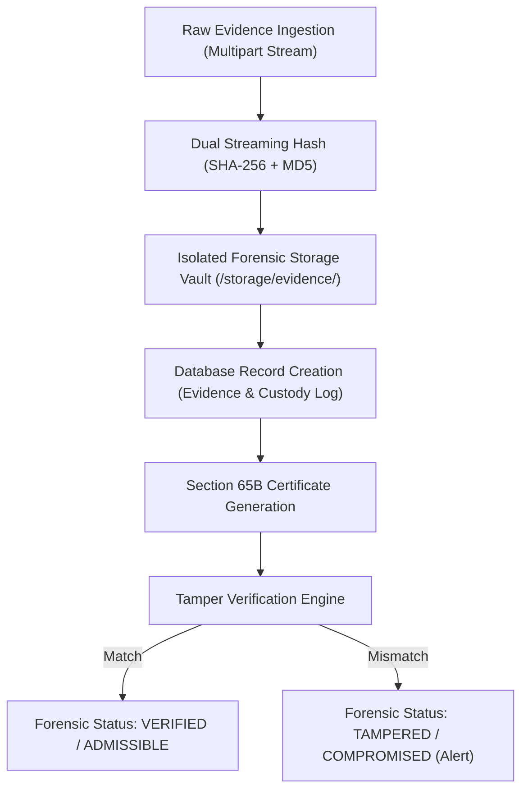

# CCIP DIGITAL EVIDENCE VAULT – CHAIN OF CUSTODY & FORENSIC INTEGRITY PROTOCOL
**Standard Operating Procedure (SOP) & Technical Architecture**
**Jurisdiction Compliance: Section 65B, Indian Evidence Act, 1872 / Section 63 Bharatiya Sakshya Adhiniyam, 2023**

---

## 1. Executive Summary & Regulatory Authority

The Cyber Crime Intelligence Platform (CCIP) enforces an immutable, forensically sound Digital Evidence Vault with cryptographically verifiable Chain of Custody (CoC). In compliance with digital forensics standards (ISO/IEC 27037:2012) and statutory requirements under Section 65B of the Indian Evidence Act (and its successor Bharatiya Sakshya Adhiniyam), every digital item submitted to CCIP—whether through the Citizen Portal Intake or Law Enforcement Forensic Upload—is immediately fingerprinted, indexed, and tracked throughout its entire lifecycle.

---

## 2. Cryptographic Integrity Lifecycle



### 2.1 Ingestion & Hash Computation
When an artifact is uploaded:
1. The stream is read into memory/disk buffer in 64 KB blocks.
2. An unalterable `SHA-256` hexadecimal digest and `MD5` checksum are calculated simultaneously.
3. The file is saved using a sanitized, non-colliding storage path (`ev_<uuid>_<filename>`) outside public web roots.
4. Permissions are locked down (`read-only` to backend service user).

### 2.2 Immutable Chain of Custody Logging
Every action on an evidence item generates an append-only entry in `evidence_custody_logs`:
- `log_id`: Unique UUID4 identifier.
- `evidence_id`: Foreign key reference with cascade protection.
- `action`: `INGESTED`, `ACCESSED`, `TRANSFERRED`, `ANALYZED`, `VERIFIED`, `EXPORTED`, or `CERTIFIED`.
- `actor_id` & `actor_role`: Identity of investigator or system process executing the action.
- `timestamp`: UTC ISO-8601 high-resolution timestamp.
- `notes`: Forensic justification and source IP address.
- `hash_at_event`: Re-calculated SHA-256 hash verified against the initial ingestion hash.

---

## 3. Section 65B Certificate Specification

Under Section 65B(4) of the Indian Evidence Act, 1872, an electronic record produced by a computer system is admissible in judicial proceedings only when accompanied by a signed certificate identifying the electronic record and describing the manner in which it was produced.

CCIP dynamically issues cryptographic Section 65B certificates (`GET /api/v1/evidence/{evidence_id}/certificate-65b`) containing:
1. **Certificate Identifier**: System-generated serial number (`CERT-65B-<YEAR>-<UUID8>`).
2. **Device & Node Identification**: Server hostname, operating system, and MAC address signature.
3. **Evidence Specification**:
   - Original filename, MIME type, file size in bytes.
   - Initial SHA-256 and MD5 hash values computed at time of capture.
4. **Lawful Device Operation Affirmation**:
   - Explicit declaration that the CCIP computing resource operated regularly and without malfunction during evidence processing.
   - Affirmation that data integrity was maintained and uncorrupted.
5. **Certifying Officer Details**:
   - Name, Officer ID, Agency/Station, and designation of the examining forensic investigator.
   - Digital signature digest of the certificate contents.

---

## 4. Anti-Tamper Verification API

CCIP exposes automated tamper detection via:
```http
POST /api/v1/evidence/{evidence_id}/verify-integrity
```
**Process:**
1. Loads the physical file from disk.
2. Computes a real-time SHA-256 hash.
3. Compares with the database baseline `file_hash`.
4. If identical: returns `status: "VERIFIED"`, `match: true`.
5. If discrepancy detected: marks status `TAMPERED`, alerts security operations, and appends a critical custody event.

---

## 5. Storage Security & File Vault Access Rules

- Storage directory: `backend/storage/evidence/`
- Direct web access: **Forbidden** (files are never exposed via static URL routing).
- Download access: **Authenticated Stream Only** (`GET /api/v1/evidence/{evidence_id}/download`) requiring role `INVESTIGATOR`, `CHIEF_ANALYST`, or `ADMIN`.
- Every download event appends an `EXPORTED` custody log with the downloading officer's credentials.
