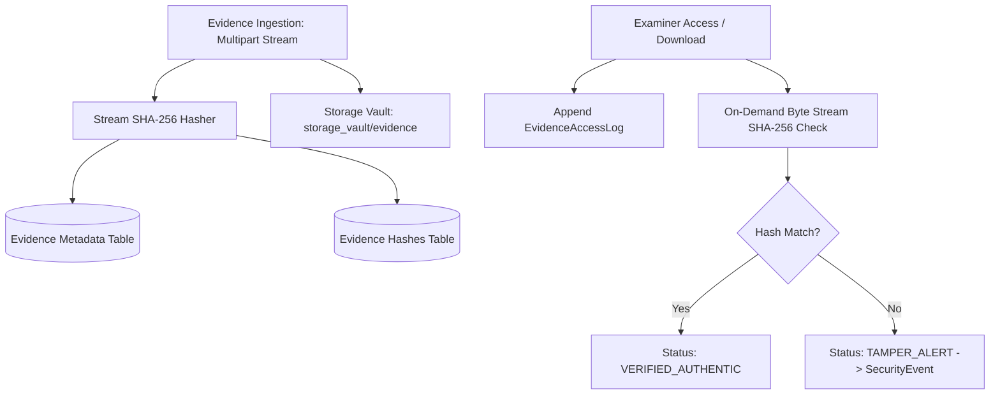

# DIGITAL EVIDENCE ARCHITECTURE & INTEGRITY ASSURANCE
## Cryptographic Integrity, Storage Vault & Forensic Proof
**Platform:** Cyber Crime Intelligence Platform (CCIP)  
**Security Clearance:** ENCLAVE RESTRICTED / FORENSIC  
**Version:** 2.0.0  

---

## 1. Storage Architecture & Vault Isolation

The CCIP Evidence Vault enforces complete physical and logical isolation between application runtime assets and judicial evidence artifacts:
- **Storage Root:** `storage_vault/evidence/`
- **Unique Storage Keys:** Artifacts are assigned non-predictable UUID-based storage keys (e.g. `storage_vault/evidence/{complaint_id}/{evidence_uuid}.bin`).
- **MIME & Byte Verification:** Files undergo magic byte inspection to detect dangerous extensions (e.g. `.exe` disguised as `.pdf`).
- **Cryptographic Hashes:** A primary SHA-256 hash is generated upon intake and stored in both `Evidence.sha256_hash` and the relational table `evidence_hashes`.

---

## 2. Integrity Verification Protocol

1. **Intake Seal:** `POST /api/v1/evidence/upload` calculates SHA-256 and seals original filename, MIME type, and size.
2. **On-Demand Check:** `GET /api/v1/evidence/{id}/verify-hash` reads the physical storage key and compares against the recorded intake hash.
3. **Court-Admissible Section 65B Certificates:** `GET /api/v1/cases/{id}/certificate-65b` generates cryptographically signed statements affirming system reliability and bit-for-bit authenticity.
