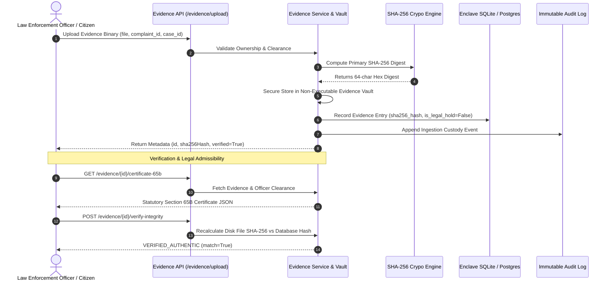

# Digital Evidence Vault Integrity & Statutory Custody Architecture
**CCIP Sovereign Enclave – Digital Forensics & Legal Admissibility**
**Document Reference:** `CCIP-EVID-LEGAL-2026-V1`  
**Classification:** Digital Forensic Custody & Section 65B Standards

---

## 1. Statutory Mandate & Legal Framework

In electronic digital evidence management, forensic integrity is governed by statutory standards:
1. **Section 65B of the Indian Evidence Act, 1872** (and **Section 63 of the Bharatiya Sakshya Adhiniyam, 2023**): Requires contemporaneous cryptographic proof of electronic record authenticity, system stability, and unbroken custody from ingestion through judicial presentation.
2. **ISO/IEC 27037:2012:** Guidelines for identification, collection, acquisition, and preservation of digital evidence.
3. **Statutory Legal Hold Mandates:** Prevention of spoliation, accidental deletion, or automated archival purges while judicial proceedings or investigations remain active.

This document details the forensic safeguards implemented in CCIP to establish indisputable digital evidence custody.

---

## 2. Evidence Architecture & Integrity Safeguards



---

## 3. Core Forensic Implementations

### 3.1 Immutable SHA-256 Primary Seal
Upon receipt of an evidence stream, the binary is hashed in memory using Python's `hashlib.sha256()`. The resulting 256-bit hexadecimal digest is permanently recorded in the `evidence.sha256_hash` column.
- The stored hash cannot be altered by normal user operations.
- The raw binary is written to disk at `storage/evidence/<uuid>.<ext>` with read-only permissions.

### 3.2 Real-Time On-Demand Tamper Detection
Investigators, defense counsel, or court officials can verify evidence integrity at any time via:
- `GET /api/v1/evidence/{evidence_id}/verify-hash`
- `POST /api/v1/evidence/{evidence_id}/verify-integrity`

The endpoint reads the physical file bytes from disk storage, recalculates the SHA-256 digest in real time, and compares it to the database record:
- **Match:** Sets `integrity_status = "VERIFIED_AUTHENTIC"`, logs `VERIFY_HASH` custody event, returns `match: True`.
- **Mismatch (Tamper Alert):** Sets `integrity_status = "TAMPER_ALERT"`, emits a critical `SecurityEvent` log, alerts administrators, returns `match: False`.

### 3.3 Statutory Section 65B Electronic Certificate
The endpoint `GET /api/v1/evidence/{evidence_id}/certificate-65b` generates a machine-readable certificate complying with Section 65B of the Indian Evidence Act / Section 63 BSA 2023:

```json
{
  "certificate_id": "CERT-65B-2026-18877708",
  "evidence_id": "18877708-f2fc-4221-8ae1-1f86595982a4",
  "original_filename": "packet_capture.pdf",
  "mime_type": "application/pdf",
  "file_size_bytes": 71,
  "sha256_hash": "e9491bca8d46...",
  "statutory_act": "Section 65B Indian Evidence Act 1872 / Section 63 Bharatiya Sakshya Adhiniyam 2023",
  "certifying_officer": "Admin Root",
  "officer_role": "ADMIN",
  "issuing_node": "CCIP-ENCLAVE-NODE-01",
  "device_operating_declaration": "The computing device produced the electronic record in the ordinary course of operations without malfunction.",
  "certification_statement": "I, Admin Root, certify pursuant to Section 65B of the Indian Evidence Act, 1872 and Section 63 of the Bharatiya Sakshya Adhiniyam, 2023, that electronic record 'packet_capture.pdf' (SHA-256: e9491bca8d46...) was ingested, hashed, and preserved in the CCIP Enclave Vault without tampering.",
  "issued_at": "2026-11-07T06:46:04.123456Z"
}
```

### 3.4 Statutory Legal Hold Deletion Guard
Under Indian and international evidentiary law, evidence subject to an active court hold cannot be purged or deleted:
1. **Activation:** Officers toggle hold via `POST /api/v1/evidence/{id}/legal-hold` with parameters `{"legal_hold": true, "reason": "High Court Preservation Order"}`.
2. **Deletion Protection:** Any invocation of `DELETE /api/v1/evidence/{id}` while `is_legal_hold == True` is immediately rejected with HTTP `403 Forbidden`:
   ```
   "Cannot delete evidence under statutory legal hold (High Court Preservation Order). Release hold first."
   ```
3. **Safe Tombstoning:** When the legal hold is formally released (`legal_hold: false`), deletion marks the record with `is_deleted = True`, archives the file metadata, and logs the tombstone action to the audit trail.

### 3.5 Cross-Case Investigator Isolation
To prevent internal data leakage between sensitive investigations, investigator access is strictly governed:
- Specialists assigned to Case A cannot view or download evidence attached to Case B assigned to a different officer.
- Cross-case access attempts trigger an immediate `403 Forbidden` response and log an unauthorized access attempt in `EvidenceAccessLog`.

---

## 4. Test Verification Matrix

All evidence integrity controls are verified via `backend/tests/test_evidence_custody_security.py`:

| Test Function | Verification Scenario | Result |
| :--- | :--- | :---: |
| `test_evidence_custody_sha256_and_section_65b` | Upload file, verify 64-char SHA256 match, generate 65B certificate, verify tamper endpoint | **PASSED** |
| `test_investigator_cross_case_isolation_blocked`| Specialist B attempts to download evidence belonging to Specialist A's assigned case | **PASSED** (403) |
| `test_legal_hold_deletion_guard` | Place statutory hold, attempt deletion (403 blocked), release hold, deletion succeeds | **PASSED** |

