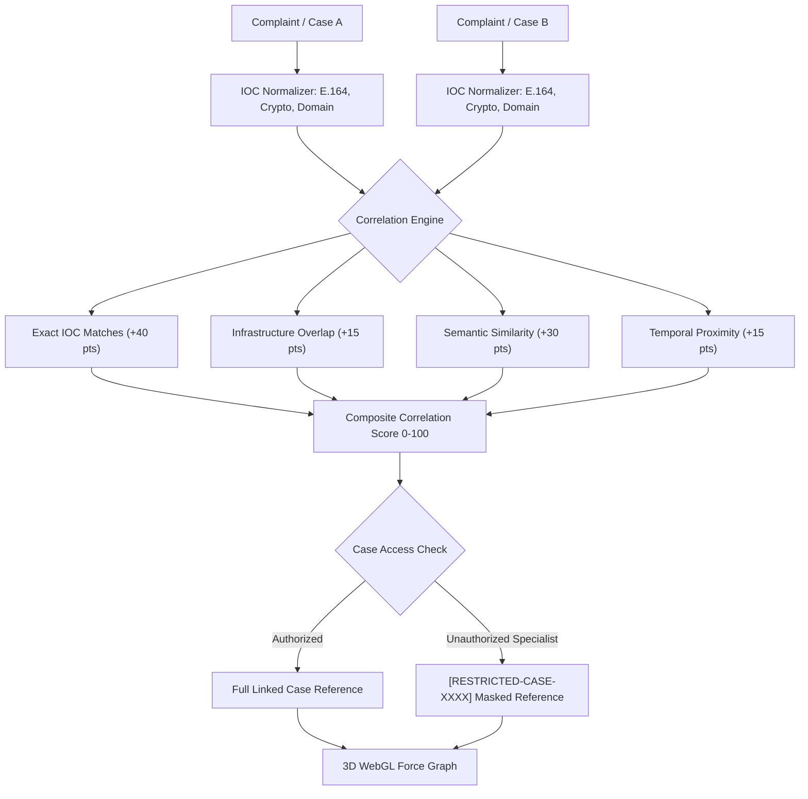

# CROSS-CASE INTELLIGENCE CORRELATION ENGINE
## Multi-Hop Indicator Correlation, Explainable Scoring & Data Isolation
**Platform:** Cyber Crime Intelligence Platform (CCIP)  
**Security Clearance:** ENCLAVE RESTRICTED / INTELLIGENCE ANALYST  
**Version:** 2.0.0  

---

## 1. Overview & Forensic Objectives

The CCIP Cross-Case Correlation Engine automatically identifies hidden operational linkages across independently filed cybercrime complaints. It correlates normalized Indicators of Compromise (IOCs)—including suspect telephone numbers, UPI IDs, cryptocurrency wallet addresses, bank account numbers, URLs, and IP subnets—while strictly preventing cross-case PII leakage to unauthorized investigators.

---

## 2. Explainable Correlation Scoring Formula

Rather than relying on opaque black-box scores, the CCIP correlation engine computes an explainable composite score:

$$\text{Composite Score} = \min\left(100, S_{\text{exact}} + S_{\text{semantic}} + S_{\text{infra}} + S_{\text{temporal}}\right)$$

1. **Exact Indicator Match ($S_{\text{exact}}$):**
   - Each identical normalized indicator (same phone number, crypto wallet, bank UTR, or suspect domain) contributes **15 points** (capped at **40 points**).
2. **Semantic Similarity ($S_{\text{semantic}}$):**
   - Cosine similarity computed between complaint narratives using Sentence-BERT (`case_similarity` model).
   - $S_{\text{semantic}} = \text{round}(\text{cosine\_similarity} \times 30)$ (capped at **30 points**).
3. **Shared Infrastructure Overlap ($S_{\text{infra}}$):**
   - Shared Autonomous System Number (ASN), IP CIDR /24 subnet, or domain registrar overlap contributes **15 points**.
4. **Temporal Proximity ($S_{\text{temporal}}$):**
   - If both incidents occurred within a 48-hour window, contributes **15 points**.

---

## 3. Cross-Case Authorization Guard & PII Isolation

To prevent Broken Object Level Authorization (BOLA/IDOR) and unauthorized intelligence leakage:
- If an investigator queries correlations for Case A, and Case B belongs to another specialist or department:
  - Case B's identifier is redacted to `[RESTRICTED-CASE-{UUID[:8]}]`.
  - Complainant name, email, phone number, and narrative of Case B are stripped.
  - Only the shared indicator value (e.g. `UPI: fraudster@okaxis`) and the explainable correlation score are presented.
- Full access to Case B requires an administrative transfer or supervisor authorization.

