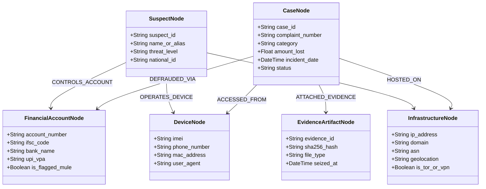

# CCIP THREAT INTELLIGENCE – ENTITY RELATIONSHIP DATA MODEL
**Knowledge Graph Topology, Graph Node Taxonomy, & Relational Edge Calculus**

---

## 1. System Overview

The CCIP Cross-Case Correlation and Threat Intelligence Engine aggregates disparate forensic indicators from citizen complaints, forensic extractions, and external threat feeds into an interconnected Knowledge Graph. The entity-relationship model enables automated detection of cybercrime syndicates, mule account rings, shared infrastructure, and serial offenders.

---

## 2. Graph Node Taxonomy

### 2.1 Entity Classes & Schema Definitions

1. **`CaseNode` (Vertex Type: CASE)**
   - Primary Identifier: `case_id` (UUID4)
   - Key Attributes: `complaint_number`, `incident_category`, `financial_loss`, `priority`, `jurisdiction`.
2. **`FinancialAccountNode` (Vertex Type: FINANCIAL_INDICATOR)**
   - Subtypes: `BANK_ACCOUNT`, `UPI_ID`, `CRYPTO_WALLET`.
   - Key Attributes: `account_num`, `ifsc`, `upi_vpa`, `mule_risk_score`.
3. **`DeviceNode` (Vertex Type: COMM_ENDPOINT)**
   - Subtypes: `PHONE_NUMBER`, `IMEI`, `IMSI`, `MAC_ADDRESS`.
   - Key Attributes: `msisdn`, `carrier`, `cdr_activity_window`.
4. **`InfrastructureNode` (Vertex Type: NETWORK_INFRA)**
   - Subtypes: `IP_ADDRESS`, `DOMAIN`, `URL`, `ASN`.
   - Key Attributes: `host`, `cidr`, `autonomous_system`, `geo_country`, `malicious_reputation_score`.
5. **`SuspectNode` (Vertex Type: ACTOR)**
   - Key Attributes: `suspect_id`, `alias`, `confidence_score`, `organization_tag`.
6. **`EvidenceArtifactNode` (Vertex Type: FORENSIC_ITEM)**
   - Key Attributes: `evidence_id`, `sha256`, `mime_type`, `custody_chain_id`.

---

## 3. Relational Edge Calculus & Correlation Metrics

Edges define semantic relationships discovered across cases. Each edge carries an algorithmic confidence weight $W \in [0.0, 1.0]$.

### 3.1 Edge Types & Formulations

| Edge Type | Source Node | Target Node | Correlation Rule | Weight ($W$) Calculation |
|---|---|---|---|---|
| `SHARED_MULE_ACCOUNT` | `CaseNode` (A) | `CaseNode` (B) | Both cases transferred funds into identical Bank Account or UPI VPA | $1.00$ (Deterministic Match) |
| `SHARED_CALLING_LINE` | `CaseNode` (A) | `CaseNode` (B) | Same contact phone / WhatsApp target identified | $0.95$ |
| `COMMON_INFRASTRUCTURE` | `CaseNode` (A) | `CaseNode` (B) | Phishing landing hosted on same IP / Subnet | $0.85$ (Unique IP) / $0.50$ (Shared CDN) |
| `CO_OCCURRING_DEVICE` | `CaseNode` (A) | `CaseNode` (B) | Same IMEI or MAC active across victim interactions | $0.98$ |
| `MODUS_OPERANDI_MATCH` | `CaseNode` (A) | `CaseNode` (B) | NLP embedding cosine similarity of complaint text $> 0.85$ | Cosine Similarity Score |

---

## 4. Graph Clustering & Syndicate Detection

CCIP utilizes Louvain Community Detection and connected components analysis on the materialized correlation graph:
1. **Cluster Identification**: Subgraphs with internal edge density $\ge 0.70$ are flagged as candidate cybercrime syndicates.
2. **Mule Network Propagation**: Transitive fund flows across multiple banking nodes ($A \to B \to C$) identify money laundering layers.
3. **Automated Cross-Case Alerts**: When a newly filed complaint shares $\ge 2$ forensic entities with existing open investigations, an automated intelligence alert is delivered to all assigned investigators.
