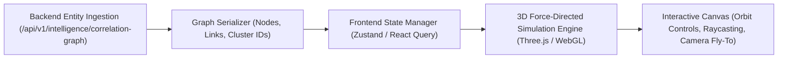

# CCIP 3D THREAT INTELLIGENCE GRAPH ARCHITECTURE
**WebGL Accelerated Multi-Dimensional Graph Visualization Engine**

---

## 1. Architectural Blueprint & Overview

The CCIP 3D Threat Intelligence Graph offers investigators an interactive, spatial view of cross-case criminal networks. By rendering high-density forensic clusters in 3D WebGL space, investigators can intuitively detect syndicate hubs, identify critical mule transfer funnels, and trace communication infrastructure across thousands of complaints.



---

## 2. Rendering Pipeline & Technical Stack

1. **Underlying Technology**:
   - **WebGL Engine**: `Three.js` (r128+) hardware-accelerated 3D renderer.
   - **Physics Simulation**: 3D Barnes-Hut $n$-body force-directed simulation.
   - **Canvas Container**: React component with auto-resizing viewport and high-DPI canvas backing.

2. **Data Structure (API Contract)**:
   ```typescript
   interface GraphData {
     nodes: Array<{
       id: string;
       name: string;
       type: 'CASE' | 'SUSPECT' | 'BANK' | 'PHONE' | 'IP' | 'DOMAIN';
       group: number;
       val: number; // Node diameter / centrality weight
       color?: string;
       metadata?: Record<string, any>;
     }>;
     links: Array<{
       source: string;
       target: string;
       relationship: string;
       weight: number;
       curvature?: number;
     }>;
   }
   ```

---

## 3. Visual Encoding & Aesthetics

To maintain high visual fidelity under cyber-forensic operational conditions:
- **Color Palette (Dark Tactical Sovereign Theme)**:
  - `CASE` nodes: `#3b82f6` (Electric Blue).
  - `SUSPECT` nodes: `#ef4444` (Crimson Alert).
  - `BANK / UPI` nodes: `#10b981` (Emerald Green).
  - `PHONE / COMM` nodes: `#f59e0b` (Amber Orange).
  - `IP / NETWORK` nodes: `#8b5cf6` (Cyber Violet).
  - `DOMAIN / URL` nodes: `#ec4899` (Neon Pink).
- **Edge Dynamics**:
  - Edge thickness represents relationship weight ($W$).
  - Particle flow animations signify directional fund transfers or active network communication packets.

---

## 4. Performance Optimization for Large Graphs ($N > 2,000$ Nodes)

1. **Adaptive Cooling & Simulation Freezing**:
   - The force simulation runs with alpha decay $\alpha = 0.02$. Once energy falls below threshold $\epsilon = 0.001$, the simulation enters sleep mode, eliminating idle GPU consumption.
2. **Raycasting & Spatial Indexing**:
   - Employs an octree acceleration structure for fast ray-intersection detection during mouse hovers and click events.
3. **Level of Detail (LOD)**:
   - Node labels and micro-text render only when the camera distance $D < 450$ units.
   - Outer nodes distant from camera are rendered as simplified sprites.
4. **Camera Fly-To Interaction**:
   - Selecting a node smoothly interpolates the 3D camera vector towards the selected entity over a 1.2-second cubic ease curve.
   - Automatically highlights immediate 1-hop and 2-hop neighbor subgraphs while dimming unrelated network nodes.
