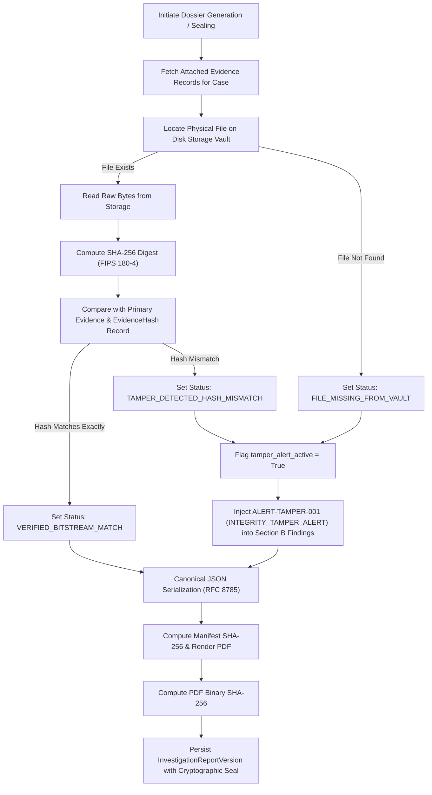

# COURT DOSSIER CRYPTOGRAPHIC INTEGRITY & EVIDENCE CUSTODY SPECIFICATION

**Subsystem:** Court-Ready Dossier Generation & Digital Evidence Verification  
**Modules:** `app.services.court_dossier_service`, `app.api.reports`, `app.models.threat_intelligence_v2`, `app.models.evidence`  
**Security Standard:** FIPS 180-4 (Secure Hash Standard SHA-256), RFC 8785 (JSON Canonicalization Scheme)  
**Legal Framework:** Section 65B Indian Evidence Act 1872 / Section 63 Bharatiya Sakshya Adhiniyam 2023 (BSA)  
**Date:** November 2026  

---

## 1. PURPOSE & JURISPRUDENTIAL CONTEXT

The CCIP Court Dossier Engine generates digitally sealed, comprehensive investigation dossiers suitable for submission in formal criminal proceedings.

### Statutory Distinction: Cryptographic Authenticity vs. Judicial Admissibility
It is a fundamental principle of evidence law that **technical cryptographic authenticity does not equate to judicial admissibility**:
- **Technical Cryptographic Authenticity:** Demonstrates through mathematics (FIPS 180-4 SHA-256 bitstream hashing and digital signatures) that binary digital evidence has remained byte-for-byte identical to the copy acquired at seizure, without modification, deletion, or tampering.
- **Judicial Admissibility:** The exclusive prerogative of the presiding Judge or Magistrate under Section 65B of the Indian Evidence Act / Section 63 of the Bharatiya Sakshya Adhiniyam (BSA), 2023, subject to witness cross-examination, relevancy, procedural lawfulness of seizure, and the competence of the certifying officer.

Every CCIP dossier prominently incorporates this statutory disclaimer to prevent procedural misrepresentation in court.

---

## 2. PRE-SEALING BITSTREAM VERIFICATION ARCHITECTURE

Prior to sealing an investigation report version and generating its cryptographic manifest digest, the system executes an automated, independent bitstream audit across every piece of attached case evidence.



---

## 3. CORE TECHNICAL CONTROLS

### 3.1 Raw Bitstream Disk Verification (`court_dossier_service.py`)
For every attached `Evidence` record:
1. The service reads the binary file directly from `storage_key` or `file_path`.
2. Computes the raw SHA-256 hexadecimal digest:
   ```python
   with open(ev_fpath, "rb") as f:
       disk_bytes = f.read()
   computed_sha = hashlib.sha256(disk_bytes).hexdigest().lower()
   ```
3. Checks against both `ev.sha256_hash` and related `EvidenceHash` table records.
4. If a mismatch is detected:
   - Sets `verification_status: TAMPER_DETECTED_HASH_MISMATCH`.
   - Sets global flag `tamper_alert_active: true`.
   - Appends high-priority forensic alert `ALERT-TAMPER-001`:
     `"EVIDENCE INTEGRITY TAMPER ALERT: File '{ev_fname}' on disk does not match the sealed cryptographic SHA-256 digest."`

### 3.2 Canonical JSON Serialization (RFC 8785 Compliant)
To ensure the cryptographic hash of a report manifest is 100% deterministic and reproducible across diverse operating systems, Python versions, and runtime environments:
- Serialization is performed with strict key sorting: `sort_keys=True`.
- Whitespace variance is eliminated: `separators=(',', ':')`.
- All timestamps are normalized to ISO 8601 UTC strings.
- Floating-point scores are normalized to fixed precision.

```python
canonical_manifest_bytes = json.dumps(
    dossier_data,
    sort_keys=True,
    separators=(',', ':'),
    default=str
).encode('utf-8')
manifest_sha256 = hashlib.sha256(canonical_manifest_bytes).hexdigest()
```

### 3.3 Binary PDF Cryptographic Seal
When the court dossier PDF is rendered via the HTML/CSS typesetting engine:
1. The output binary PDF bytes are immediately hashed with SHA-256.
2. The resulting `pdf_binary_sha256` is persisted in the database record `InvestigationReportVersion.pdf_binary_sha256`.
3. If an adversary attempts to modify the PDF on disk or during transmission (e.g., editing suspect names or bank accounts), verifying the file against `pdf_binary_sha256` will immediately expose the alteration.

---

## 4. CRYPTOGRAPHIC VERIFICATION ENDPOINT

To enable court personnel, defense counsel, and senior officers to independently verify a dossier without access to the full CCIP application database:

- **Endpoint:** `GET /api/v1/reports/court-dossier/{report_code}/verify`
- **Authentication:** Public or RBAC-governed (depends on case sensitivity configuration)
- **Validation Pipeline:**
  1. Retrieves the sealed `InvestigationReportVersion` by unique `report_code` (e.g., `REP-A8B9C10D`).
  2. Loads the stored `manifest_data` JSON.
  3. Re-serializes the data into canonical format and re-computes the SHA-256 digest.
  4. Checks the rendered PDF on disk (if available) and re-computes its binary SHA-256 digest.
  5. Evaluates `tamper_alert_active` and individual evidence verification statuses.

### Sample Verification Response (Clean Record):
```json
{
  "report_code": "REP-D7521B04",
  "version_number": 1,
  "case_id": "c-001",
  "dossier_type": "COURT_SUBMISSION_COMPREHENSIVE",
  "sealed_at": "2026-11-07T14:30:00Z",
  "verified_by_cryptography": true,
  "manifest_sha256_match": true,
  "computed_manifest_sha256": "4b68ff098c4d29...a1",
  "stored_manifest_sha256": "4b68ff098c4d29...a1",
  "pdf_binary_sha256": "7c12ee98a12b4...ef",
  "pdf_file_verified": true,
  "evidence_tamper_detected": false,
  "total_evidence_items": 3,
  "verified_evidence_items": 3,
  "tampered_evidence_items": 0,
  "judicial_admissibility_notice": "Cryptographic verification confirms data integrity and absence of tampering since sealing. Admissibility under Section 65B/63 is subject to judicial discretion."
}
```

### Sample Verification Response (Tampered Evidence Record):
```json
{
  "report_code": "REP-D7521B04",
  "version_number": 1,
  "verified_by_cryptography": false,
  "manifest_sha256_match": true,
  "evidence_tamper_detected": true,
  "tampered_evidence_items": 1,
  "integrity_status": "INTEGRITY_TAMPER_ALERT_ACTIVE",
  "evidence_details": [
    {
      "evidence_id": "ev-001",
      "file_name": "suspect_payload.exe",
      "verification_status": "TAMPER_DETECTED_HASH_MISMATCH"
    }
  ]
}
```

---

## 5. SECTION 65B / SECTION 63 LEGAL SCHEDULE COMPLIANCE

The generated dossier automatically incorporates Section E (Forensic Integrity & Hash Ledger) and Section F (Section 65B / Section 63 Certificate Schedule):
1. **Device & Environment Description:** Records the hostname, OS version, cryptographic libraries, and server IP of the certifying environment.
2. **Chain of Custody Timeline:** Documents original acquisition timestamp, officer ID, primary hash, secondary hash, and secure storage vault location.
3. **Statutory Affirmation:** Contains the statutory certificate text affirmed by the lead digital forensics specialist certifying that the computer system operated properly without unauthorized interference during the extraction and generation period.

---

## 6. AUTOMATED VERIFICATION RESULTS

- `test_10_court_dossier_tamper_detection`: **PASSED** (verifies that modifying raw file bytes on disk triggers `TAMPER_DETECTED_HASH_MISMATCH` and activates `ALERT-TAMPER-001`).
- `test_11_court_dossier_verification_endpoint`: **PASSED** (verifies endpoint execution, canonical re-hashing, and detection of seal tampering).
- `test_18_court_dossier_generation` (Stage 12 Suite): **PASSED** (verifies generation of complete Sections A through F).
- `test_19_court_dossier_pdf_rendering` (Stage 12 Suite): **PASSED** (verifies PDF generation and binary SHA-256 calculation).

