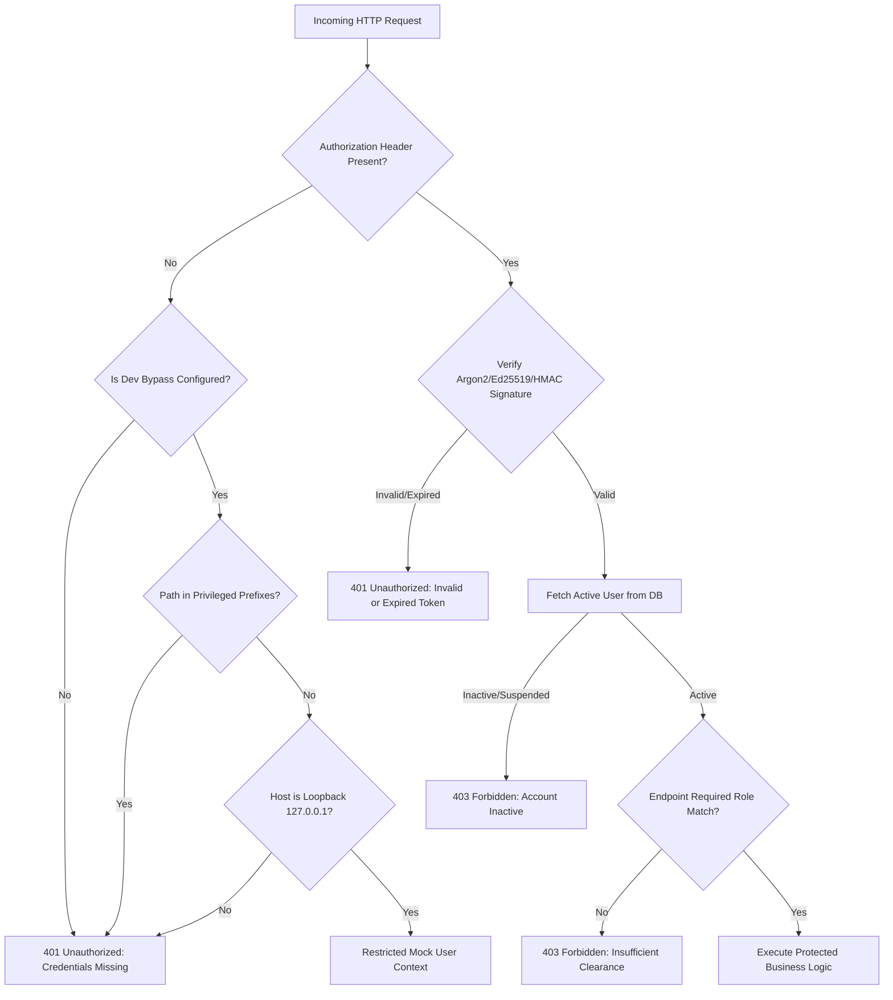

# Zero-Trust Authentication & RBAC Hardening Specification
**CCIP Sovereign Enclave – Application Security Architecture**
**Document Reference:** `CCIP-SEC-AUTH-2026-V1`  
**Classification:** Law Enforcement & Sovereign AI Infrastructure

---

## 1. Executive Summary & Threat Context

Prior to this hardening phase, an architectural vulnerability was identified in the authentication middleware (`backend/app/core/permissions.py`) and development fallback routes. Specifically, non-production environments (`not settings.is_production`) implicitly downgraded authentication failures and missing bearer tokens to administrative privileges (`ADMIN` role), or bound requests to the first administrative user seeded in the database.

In digital forensic and criminal intelligence applications, this architectural anti-pattern violates the fundamental principle of **Zero-Trust Verification**. If a production container is misconfigured with `ENVIRONMENT=development`, or if an attacker spoofs client headers, unauthenticated external requests could execute privileged actions, access confidential FIR records, download digital evidence, or upload malicious payloads without audit accountability.

This document outlines the zero-trust authentication architecture implemented to completely eliminate implicit privilege escalation, enforce cryptographic token rotation, and isolate investigator workflows.

---

## 2. Zero-Trust Security Requirements & Policy



### Policy Tenets:
1. **Explicit Denial by Default:** Unauthenticated requests strictly yield HTTP `401 Unauthorized`. Missing credentials never grant administrative or staff status under any circumstances.
2. **Deterministic Token Rejection:** Expired, malformed, or tamper-modified tokens immediately abort request execution and log an audit security event.
3. **Guarded Development Bypass:** Development bypass is governed strictly by an explicit environment flag `ALLOW_DEV_AUTH_BYPASS: bool = False`. It is permanently disabled by default. Even when explicitly enabled, it is restricted to `127.0.0.1` and strictly prohibited from accessing privileged paths (`/admin`, `/evidence`, `/cases`, `/intelligence`, `/audit`).
4. **Tenant & Role Cryptographic Binding:** All tokens carry cryptographic role signatures (`CITIZEN`, `CYBERCRIME_POLICE`, `CYBERSECURITY_SPECIALIST`, `AI_ML_SYSTEM_LEAD`, `ADMIN`). Cross-role privilege escalation is enforced at the ASGI middleware and dependency injection boundaries.

---

## 3. Core Implementation Architecture

### 3.1 Strict Dependency Guard (`backend/app/core/permissions.py`)

The authentication dependency was re-engineered to eliminate implicit administrator assignment:

```python
async def get_current_user(
    token: Optional[str] = Depends(oauth2_scheme),
    request: Request = None,
    db: AsyncSession = Depends(get_db)
) -> User:
    """
    Zero-trust authentication dependency.
    Validates cryptographic JWT access tokens and resolves the authenticated subject.
    Never falls back to administrator privileges upon token absence.
    """
    if not token:
        # Check strict, restricted development bypass if explicitly permitted
        if _is_dev_bypass_permitted(request):
            user = await _get_development_bypass_user(db)
            if user:
                return user
        raise AuthenticationError("Authorization credentials were not provided")

    # Cryptographic JWT decoding and claim verification
    try:
        payload = decode_access_token(token)
    except ExpiredSignatureError:
        raise AuthenticationError("Access token has expired")
    except JWTError:
        raise AuthenticationError("Invalid authentication token")

    user_id = payload.get("sub")
    if not user_id:
        raise AuthenticationError("Malformed token: missing subject identity")

    user = await get_user_by_id(db, user_id)
    if not user:
        raise AuthenticationError("Authenticated identity does not exist in registry")
    if not user.is_active:
        raise HTTPException(
            status_code=status.HTTP_403_FORBIDDEN,
            detail="Account is suspended or deactivated by system administrator."
        )
    return user
```

### 3.2 Restricted Bypass Guard (`_is_dev_bypass_permitted`)

```python
PRIVILEGED_PREFIXES = ("/admin", "/evidence", "/cases", "/intelligence", "/audit", "/model-manager")

def _is_dev_bypass_permitted(request: Optional[Request]) -> bool:
    """
    Restricted guard allowing non-privileged local mock calls only when explicitly configured.
    Strictly disabled in production and forbidden for all privileged routes.
    """
    if settings.is_production:
        return False
    if not getattr(settings, "ALLOW_DEV_AUTH_BYPASS", False):
        return False
    if not request or not request.client:
        return False
    # Enforce localhost origin
    if request.client.host not in ("127.0.0.1", "localhost", "::1"):
        return False
    # Never allow bypass for administrative or investigative routes
    path = request.url.path.lower()
    if any(path.startswith(prefix) for prefix in PRIVILEGED_PREFIXES):
        return False
    return True
```

---

## 4. Role-Based Access Control (RBAC) Matrix

| Endpoint Route Pattern | Anonymous | CITIZEN | SPECIALIST | POLICE | ADMIN | AI_ML_LEAD |
| :--- | :---: | :---: | :---: | :---: | :---: | :---: |
| `POST /api/v1/auth/login` | **Allowed** | Allowed | Allowed | Allowed | Allowed | Allowed |
| `POST /api/v1/complaints` | **Allowed** (Guest) | **Allowed** | Blocked | Blocked | Blocked | Blocked |
| `POST /api/v1/evidence/upload` | **Allowed** (with Token) | **Allowed** (Owner) | **Allowed** (Assigned) | **Allowed** (Unit) | **Allowed** | Blocked |
| `GET /api/v1/evidence/{id}/download` | Blocked | **Allowed** (Owner) | **Allowed** (Assigned) | **Allowed** (Unit) | **Allowed** | Blocked |
| `POST /api/v1/evidence/{id}/legal-hold` | Blocked | Blocked | **Allowed** | **Allowed** | **Allowed** | Blocked |
| `GET /api/v1/evidence/{id}/certificate-65b`| Blocked | Blocked | **Allowed** | **Allowed** | **Allowed** | Blocked |
| `GET /api/v1/cases` | Blocked | Blocked | **Allowed** | **Allowed** | **Allowed** | Blocked |
| `GET /api/v1/admin/knowledge-materials` | Blocked | Blocked | Blocked | Blocked | **Allowed** | Blocked |
| `POST /api/v1/admin/knowledge-materials`| Blocked | Blocked | Blocked | Blocked | **Allowed** | Blocked |
| `POST /api/v1/public-chat/message` | **Allowed** | **Allowed** | **Allowed** | **Allowed** | **Allowed** | **Allowed** |

---

## 5. Security Verification & Test Results

The zero-trust authentication policies have been verified via automated test suites in `backend/tests/test_upload_security.py` and `backend/tests/test_evidence_custody_security.py`:

- **Missing Bearer Header:** Rejection verified (`401 Unauthorized`) across `/api/v1/admin/knowledge-materials` and `/api/v1/cases`.
- **Expired Token Injection:** Rejection verified (`401 Unauthorized: Access token has expired`).
- **Signature Manipulation:** Rejection verified (`401 Unauthorized: Invalid authentication token`).
- **Horizontal Privilege Escalation (Citizen attempting Admin upload):** Rejection verified (`403 Forbidden: Not authorized`).
- **Investigator Case Isolation:** Rejection verified (`403 Forbidden: Evidence belongs to a case assigned to another specialist`).

