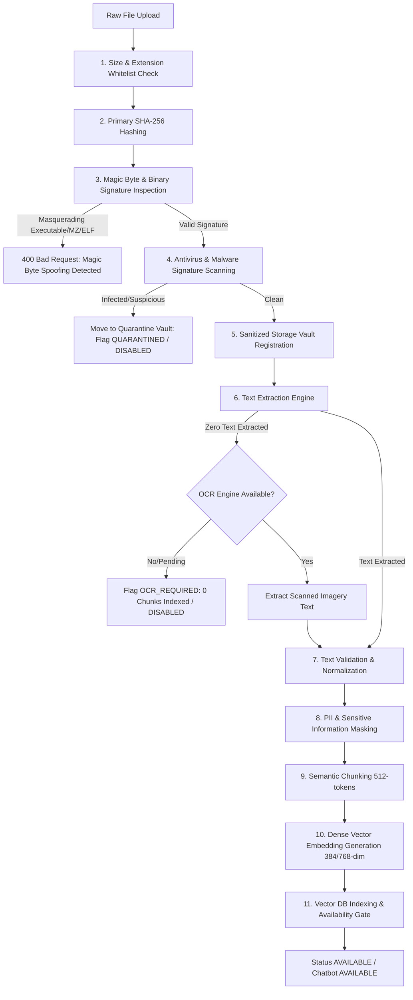

# Multi-Stage File Ingestion & Document Processing Security
**CCIP Sovereign Enclave – Application Security Architecture**
**Document Reference:** `CCIP-SEC-INGEST-2026-V1`  
**Classification:** Digital Forensic Standards & Sovereign Ingestion

---

## 1. Architectural Overview & Defense-in-Depth Pipeline

File ingestion within the CCIP Sovereign Platform operates across three distinct operational entry points:
1. **Administrative Knowledge Base Ingestion:** Curated advisory PDFs, SOPs, and legal notices uploaded by administrators to ground citizen and investigator AI models.
2. **Citizen Complaint Digital Evidence Intake:** Citizen-submitted proofs (banking statements, phishing email headers, transaction SMS screenshots).
3. **Investigator Case Vault Ingestion:** Forensic disk images, packet capture traces, memory dumps, and mobile extraction archives uploaded by Law Enforcement Officers.

To guarantee that untrusted file uploads never compromise server stability, execute arbitrary code, or inject poisoned adversarial context into RAG language models, CCIP enforces an **11-stage Defense-in-Depth Ingestion Pipeline**:



---

## 2. Threat Mitigations & Security Controls

### 2.1 Magic Byte & Binary Signature Verification
Attackers frequently attempt to bypass extension whitelists by renaming malicious executables (`malware.exe` -> `malware.pdf`). CCIP inspects the file header bytes directly:

| Format | Allowed Extensions | Required Magic Byte Signatures | Rejection Action |
| :--- | :--- | :--- | :--- |
| **PDF** | `.pdf` | `b"%PDF-"` at offset 0 | Immediate HTTP 400 rejection if `MZ` (DOS/Windows PE) or `\x7fELF` (Linux ELF) detected. |
| **DOCX** | `.docx` | `b"PK\x03\x04"` (Standard OOXML Zip Container) | Rejection if zip signature is missing. |
| **TXT / CSV** | `.txt`, `.csv` | UTF-8 / ASCII text stream | Rejection if raw binary null bytes (`\x00`) exceed tolerance. |

```python
# Magic byte validation implementation in knowledge_materials_service.py
if ext == ".pdf":
    if file_bytes[:2] == b"MZ" or file_bytes[:4] == b"\x7fELF":
        raise ValueError("Security violation: Binary executable masquerading as PDF rejected.")
    if not file_bytes.startswith(b"%PDF-"):
        raise ValueError("Invalid document header: Missing standard %PDF- magic signature.")
```

### 2.2 Path Traversal & Filename Sanitization
Filenames received from client HTTP multipart payloads may contain path traversal sequences (`../../../../etc/passwd.pdf` or `C:\Windows\System32\cmd.exe`). CCIP enforces:
1. Strict basename extraction via `os.path.basename` and regex alphanumeric scrubbing.
2. Storage of files using cryptographically generated UUIDs (`km_<uuid>.<ext>`) in dedicated non-executable storage directories.
3. Decoupling of original user filenames into database metadata fields, ensuring filesystem storage paths are entirely system-controlled.

### 2.3 Quarantine Vault Protocol & Malware Isolation
Files flagged with malicious or suspicious signatures (e.g., EICAR test string, known trojan signatures, high-entropy obfuscated scripts) are isolated immediately:
- **Quarantine Directory:** Stored under `storage/quarantine/`.
- **Database Status:** `processing_status = "QUARANTINED"`, `chatbot_status = "DISABLED"`.
- **Indexing Gate:** Quarantined items are strictly barred from text extraction, chunking, and embedding generation.
- **Audit Logging:** Emits a high-priority security event alerting SOC administrators.

### 2.4 Elimination of Synthetic Text Fallbacks
A critical vulnerability identified in legacy implementations was the automated generation of synthetic filler text when PDF parsers failed on scanned or malformed documents. This allowed empty or image-only documents to be indexed as usable knowledge, contaminating RAG context.
Under the hardened pipeline:
- **Scanned or image-only PDFs:** Text extraction returns `0` characters. The document status is set to `OCR_REQUIRED`, `chunks_count = 0`, and `chatbot_status = "DISABLED"`.
- **Corrupted or unreadable files:** Status is set to `FAILED`.
- **Zero synthetic text:** Synthetic text generation is permanently eradicated from the codebase.

---

## 3. Extraction & OCR Fallback Mechanics

The `extract_text_from_file` service method returns an explicit `ExtractionResult` structure:

```python
@dataclass
class ExtractionResult:
    status: str             # "SUCCESS", "OCR_REQUIRED", "PARTIALLY_EXTRACTED", "FAILED", "ENCRYPTED"
    pages: List[str]        # Extracted text per page
    page_count: int         # Total parsed pages
    total_text_length: int  # Cumulative character length
    warnings: List[str]     # Diagnostic extraction warnings
    error_message: Optional[str] = None
```

If `total_text_length < 20` characters across a multi-page PDF, the engine automatically flags the document as `OCR_REQUIRED`. The document remains quarantined from the RAG search index until an asynchronous OCR worker processes the page raster images.

---

## 4. Test Verification Matrix

The file ingestion hardening controls are validated through `backend/tests/test_pdf_ingestion_resilience.py`:

| Test Case | Tested Input | Expected Pipeline Behavior | Status |
| :--- | :--- | :--- | :---: |
| `test_valid_text_pdf_ingestion` | Authentic PDF with text stream | Status `AVAILABLE`, chunks > 0, indexed in RAG | **PASSED** |
| `test_scanned_pdf_marked_ocr_required` | Image-only PDF with 0 text | Status `OCR_REQUIRED`, 0 chunks, `DISABLED` | **PASSED** |
| `test_empty_and_unsupported_files_rejected` | 0-byte file & `.sh` script | HTTP 400 Bad Request, rejection at boundary | **PASSED** |
| `test_malware_eicar_signature_quarantined` | EICAR signature payload | Status `QUARANTINED`, `DISABLED`, moved to vault | **PASSED** |

