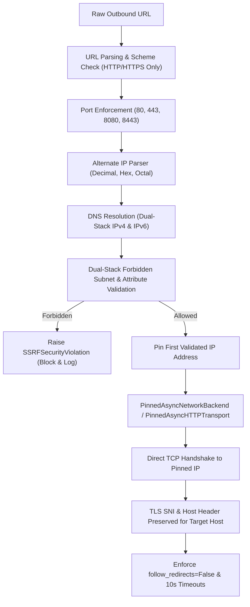

# OUTBOUND THREAT FEED CONNECTION SECURITY SPECIFICATION

**Subsystem:** Cyber Threat Intelligence Ingestion & Outbound Transport  
**Module:** `app.services.threat_ssrf_guard`  
**Security Level:** CRITICAL (Defense-in-Depth Network Boundary)  
**Standard Compliance:** RFC 1918, RFC 3927, RFC 4193, RFC 4291, RFC 6598, FIPS 180-4  
**Date:** November 2026  

---

## 1. THREAT MODEL & ARCHITECTURAL PROBLEM

External threat intelligence feeds (AlienVault OTX, URLhaus, AbuseIPDB, TAXII servers, MISP instances, and VirusTotal) require the CCIP backend to initiate outbound HTTP/HTTPS requests to ingest indicator sets.

Untrusted external inputs—such as user-configured TAXII/MISP URLs, feed metadata URLs, or dynamic indicator download links—expose the backend to severe Server-Side Request Forgery (SSRF) and DNS Rebinding vulnerabilities.

### 1.1 The DNS Rebinding TOCTOU Vulnerability
Conventional SSRF validation performs a DNS resolution check prior to issuing an HTTP request:
1. **Time-of-Check (TOC):** The application resolves `malicious-domain.com`. The attacker's authoritative DNS server returns a benign public IP address (e.g., `8.8.8.8`). The SSRF validator checks this IP, verifies it is public, and approves the request.
2. **Time-of-Use (TOU):** The standard HTTP client (`httpx.AsyncClient` or `requests.get`) resolves `malicious-domain.com` a second time to establish the TCP connection. The attacker's DNS server now responds with `127.0.0.1` or `169.254.169.254` (TTL=0).
3. **Exploitation:** The backend opens a connection to internal loopback services, database ports, or cloud instance metadata endpoints.

---

## 2. DEFENSIVE ARCHITECTURE & IMPLEMENTATION

CCIP eliminates DNS Rebinding and SSRF evasion through a multi-tiered inspection and socket pinning pipeline implemented in `backend/app/services/threat_ssrf_guard.py`.



---

## 3. CORE SECURITY CONTROLS

### 3.1 Socket-Level IP Pinning (`PinnedAsyncNetworkBackend` & `PinnedAsyncHTTPTransport`)
To ensure the IP checked during validation is the exact IP used for the socket connection, CCIP implements custom transport layers:
- **`PinnedAsyncNetworkBackend`:** Extends `httpcore.AnyIOBackend`. When `connect_tcp` is invoked, it overrides the target host with the pre-validated `pinned_ip`, completely bypassing second-lookup DNS resolution.
- **`PinnedAsyncHTTPTransport`:** Extends `httpx.AsyncHTTPTransport` to route all connection pooling through the pinned network backend.
- **TLS SNI & Host Integrity:** The original domain name is passed to the TLS handshake (`server_hostname=host`) and preserved in the HTTP `Host` header. This ensures valid certificate verification and virtual-host routing without re-resolving the domain.

```python
class PinnedAsyncNetworkBackend(httpcore.AnyIOBackend):
    def __init__(self, pinned_ip: str):
        super().__init__()
        self.pinned_ip = pinned_ip

    async def connect_tcp(self, host: str, port: int, timeout: Optional[float] = None, local_address: Optional[str] = None, socket_options=None):
        # Force the connection directly to the pre-validated IP address
        return await super().connect_tcp(
            host=self.pinned_ip,
            port=port,
            timeout=timeout,
            local_address=local_address,
            socket_options=socket_options
        )
```

### 3.2 Alternate Numerical IP Encoding Detection (`parse_alternate_ip`)
Attackers frequently bypass regex-based IP filters using alternative base representations. The `parse_alternate_ip` engine normalizes and decodes:
- **Decimal Integer Representation:** E.g., `http://2130706433/` (`2130706433` -> `127.0.0.1`).
- **Hexadecimal Representation:** E.g., `http://0x7f000001/` or `http://0x7f.0x0.0x0.0x1/` -> `127.0.0.1`.
- **Octal Representation:** E.g., `http://0177.0000.0000.0001/` or `017700000001` -> `127.0.0.1`.
- **Dotted Hybrid Forms:** Any mix of octal, decimal, and hexadecimal byte segments.

Any decoded IP is immediately subjected to the full subnet and property validation suite.

### 3.3 Dual-Stack Forbidden Subnet & IPv4-Mapped IPv6 Enforcement
The `check_ip_security` engine evaluates the destination against explicit attributes and CIDR ranges:

#### Forbidden Network Blocks:
| Category | Subnet Range | Rationale |
| :--- | :--- | :--- |
| **IPv4 Loopback** | `127.0.0.0/8` | Localhost services |
| **RFC 1918 Private** | `10.0.0.0/8`, `172.16.0.0/12`, `192.168.0.0/16` | Internal network resources |
| **RFC 3927 Link-Local** | `169.254.0.0/16` | Cloud metadata endpoints (`169.254.169.254`) |
| **RFC 6598 CGNAT** | `100.64.0.0/10` | Carrier-grade NAT address space |
| **RFC 5737 Test Net** | `192.0.2.0/24`, `198.51.100.0/24`, `203.0.113.0/24` | Documentation & benchmark blocks |
| **IPv6 Loopback** | `::1/128` | Localhost IPv6 |
| **IPv6 Unique Local** | `fc00::/7` | Private IPv6 subnets |
| **IPv6 Link-Local** | `fe80::/10` | Internal link communication |
| **IPv4-Mapped IPv6** | `::ffff:0:0/96` | IPv4 addresses embedded in IPv6 headers |
| **AWS IPv6 Metadata** | `fd00:ec2::254/128` | EC2 Instance Metadata Service v2 (IMDSv2) |

#### IPv4-Mapped IPv6 Unpacking:
When an IPv6 address falls within `::ffff:0:0/96`, the parser extracts `ip_obj.ipv4_mapped` and recursively evaluates the embedded IPv4 address against all IPv4 rules. For example, `[::ffff:127.0.0.1]` or `[::ffff:a00:1]` is extracted to `127.0.0.1` or `10.0.0.1` and blocked with `SSRFSecurityViolation`.

### 3.4 HTTP Redirect Handling
Automated threat feed connectors strictly configure `follow_redirects=False`. If an external server responds with an HTTP 301, 302, 307, or 308 redirect, the client does NOT follow it automatically. This prevents an external feed from redirecting the backend into an internal or unapproved endpoint.

### 3.5 Timeouts & Transport Limits
All outbound client sessions enforce:
- **Connect Timeout:** 10.0 seconds
- **Read Timeout:** 10.0 seconds
- **Write Timeout:** 10.0 seconds
- **Pool Limits:** `max_keepalive_connections=5`, `max_connections=10`

---

## 4. VERIFICATION EVIDENCE

The SSRF protection layer has been verified under automated test execution (`backend/tests/test_stage_12_1_security_hardening.py`):
- `test_01_ssrf_ipv4_mapped_ipv6_blocking`: **PASSED** (verifies loopback, cloud metadata, and private IPv4-mapped IPv6 formats).
- `test_02_ssrf_alternate_ip_representations_blocking`: **PASSED** (verifies decimal, hex, and octal integer formats).
- `test_03_ssrf_alternate_ip_parser_unit`: **PASSED** (verifies parser unit boundaries).
- `test_04_ssrf_socket_ip_pinning_transport`: **PASSED** (verifies `PinnedAsyncNetworkBackend` establishes connections using the pinned IP address).
- `test_09_ssrf_protection` (Stage 12 Suite): **PASSED** (verifies standard loopback, metadata, and private RFC 1918 blocks).
