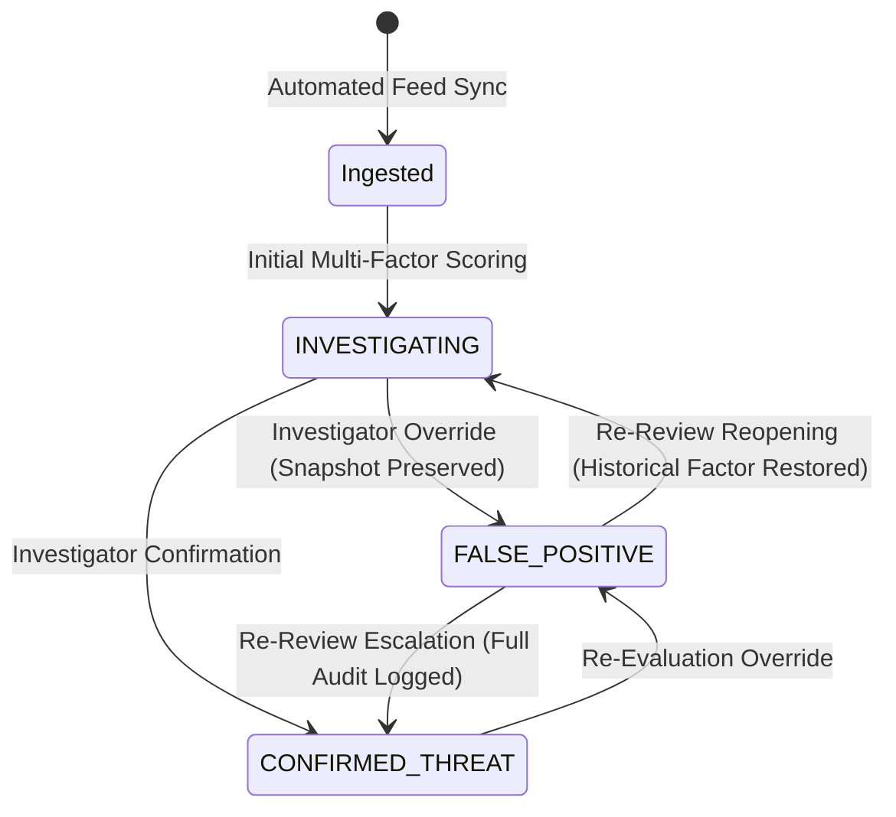

# THREAT SCORING AUDIT TRAIL & FALSE-POSITIVE GOVERNANCE SPECIFICATION

**Subsystem:** Cyber Threat Intelligence Scoring & Governance  
**Modules:** `app.services.threat_scoring_engine`, `app.models.threat_intelligence_v2`, `app.api.threat_intel`  
**Security Level:** HIGH (Auditability, Non-Repudiation & Judicial Evidentiary Integrity)  
**Date:** November 2026  

---

## 1. OBJECTIVE & BACKGROUND

Threat intelligence indicators ingested into CCIP are dynamically scored by the multi-factor scoring engine (`threat_scoring_engine.py`) using base severity, source confidence, temporal recency decay, sighting frequency, and MITRE ATT&CK kill-chain weight.

In real-world cybercrime investigations, an indicator (e.g., an IP address hosting a legitimate CDN or shared reverse proxy) may be designated by an investigator as a `FALSE_POSITIVE`. 

### The Audit Vulnerability in Naive Implementations:
In destructive scoring systems, marking an indicator as `FALSE_POSITIVE` wipes out the calculated composite score (setting it to 0.0) and discards the underlying analytical factors. When the case reaches trial or undergoes judicial review months later, investigators cannot demonstrate:
1. Why the system initially flagged the indicator as malicious.
2. What specific evidence or external feed scores contributed to the initial alert.
3. Who approved the false-positive exception and what justification was provided.

CCIP Stage 12.1 establishes **immutable scoring history preservation** and **controlled re-review governance**.

---

## 2. RELATIONAL DATA MODEL & SCHEMA

### 2.1 ThreatIndicator Enhancements
The primary `threat_indicators` table maintains both the active score state and an append-only JSON history log:

```python
class ThreatIndicator(Base):
    __tablename__ = "threat_indicators"

    # Active Scoring
    threat_score = Column(Float, default=0.0, nullable=False, index=True)
    confidence = Column(Float, default=0.5, nullable=False)
    finding_state = Column(String(50), default="INVESTIGATING", nullable=False, index=True)
    
    # Audit Trail JSON Array
    historical_scores_json = Column(JSON, default=list, nullable=False)
```

### 2.2 Relational Audit Table (`threat_indicator_review_audits`)
To support structured SQL analytics, compliance queries, and indexing, every manual state transition or override is permanently persisted in `threat_indicator_review_audits`:

```python
class ThreatIndicatorReviewAudit(Base):
    __tablename__ = "threat_indicator_review_audits"

    id = Column(String(36), primary_key=True, default=lambda: str(uuid.uuid4()))
    indicator_id = Column(String(36), ForeignKey("threat_indicators.id", ondelete="CASCADE"), nullable=False, index=True)
    reviewed_by_id = Column(String(36), ForeignKey("users.id", ondelete="SET NULL"), nullable=True, index=True)
    
    prior_state = Column(String(50), nullable=False)
    new_state = Column(String(50), nullable=False)
    prior_score = Column(Float, nullable=False)
    new_score = Column(Float, nullable=False)
    
    override_reason = Column(Text, nullable=False)
    breakdown_snapshot = Column(JSON, default=dict, nullable=False)
    created_at = Column(DateTime, default=lambda: datetime.now(timezone.utc), nullable=False)
```

---

## 3. SCORING PRESERVATION & RE-REVIEW WORKFLOW



### 3.1 Non-Destructive False-Positive Handling
When an indicator transitions to `FALSE_POSITIVE`:
1. The engine records a snapshot of the current composite score and factor breakdown:
   - `base_score` (Normalized source severity: Low=25, Medium=50, High=75, Critical=95)
   - `confidence_weight` (Source reliability: 0.1 to 1.0)
   - `recency_decay` (Exponential half-life decay based on days since sighting)
   - `sighting_multiplier` (Frequency scaling capped at 1.4x)
   - `kill_chain_multiplier` (MITRE stage weight: Weaponization to Impact)
2. `ThreatIndicator.threat_score` is displayed as `0.0` for filtering and alert deduplication.
3. The original score and full factor breakdown are appended to `historical_scores_json` along with:
   - `transition_type`: `"MARK_FALSE_POSITIVE"`
   - `prior_score`: e.g. `78.5`
   - `effective_score`: `0.0`
   - `override_reason`: Investigator's mandatory written justification
   - `reviewed_by`: Reviewer's user ID and authenticated email
   - `timestamp`: UTC ISO 8601 string

### 3.2 Controlled Re-Review Execution
If new evidence emerges (e.g., an IP address previously classified as a benign CDN is confirmed to host an active C2 node):
1. An authorized investigator issues a transition to `CONFIRMED_THREAT` or `INVESTIGATING`.
2. The engine recalculates the composite score or restores the preserved baseline factors.
3. A new audit record is inserted into `threat_indicator_review_audits` capturing the transition from `FALSE_POSITIVE` -> `CONFIRMED_THREAT`, maintaining an unbroken chain of custody for analytical conclusions.

---

## 4. API SPECIFICATION

### 4.1 Update Finding State & Score Override
- **Endpoint:** `PUT /api/v1/threat-intel/indicators/{indicator_id}/finding-state`
- **RBAC Guard:** `INVESTIGATOR`, `SPECIALIST`, `ADMIN`
- **Request Body:**
```json
{
  "finding_state": "FALSE_POSITIVE",
  "override_reason": "IP belongs to Akamai CDN edge node verified through reverse DNS and origin TLS cert.",
  "override_score": 0.0
}
```
- **Response (200 OK):**
```json
{
  "status": "success",
  "indicator_id": "9b1deb4d-3b7d-4bad-9bdd-2b0d7b3dcb6d",
  "finding_state": "FALSE_POSITIVE",
  "threat_score": 0.0,
  "prior_score": 82.4,
  "audit_recorded": true
}
```

### 4.2 Retrieve Indicator Audit History
- **Endpoint:** `GET /api/v1/threat-intel/indicators/{indicator_id}/history`
- **RBAC Guard:** `INVESTIGATOR`, `SPECIALIST`, `ADMIN`
- **Response (200 OK):**
```json
{
  "indicator_id": "9b1deb4d-3b7d-4bad-9bdd-2b0d7b3dcb6d",
  "indicator_value": "198.51.100.42",
  "current_state": "FALSE_POSITIVE",
  "current_score": 0.0,
  "history_records": [
    {
      "audit_id": "c1f7b889-1830-4e55-8a21-93bfb17e1a38",
      "prior_state": "INVESTIGATING",
      "new_state": "FALSE_POSITIVE",
      "prior_score": 82.4,
      "new_score": 0.0,
      "override_reason": "IP belongs to Akamai CDN edge node verified through reverse DNS and origin TLS cert.",
      "reviewed_by_id": "u-42-specialist",
      "reviewed_by_email": "a.thorne@astraea.gov",
      "created_at": "2026-11-07T14:32:00Z",
      "breakdown_snapshot": {
        "base_severity": 75.0,
        "confidence": 0.85,
        "recency_multiplier": 1.0,
        "sighting_multiplier": 1.15,
        "kill_chain_multiplier": 1.1
      }
    }
  ]
}
```

---

## 5. AUTOMATED VERIFICATION RESULTS

- `test_05_scoring_history_preservation_on_false_positive`: **PASSED** (verifies score factors preserved and not overwritten upon `FALSE_POSITIVE` mark).
- `test_06_indicator_review_history_endpoint_and_rereview`: **PASSED** (verifies history retrieval, multi-stage transitions, and relational audit logging).
- `test_14_false_positive_handling` (Stage 12 Suite): **PASSED** (verifies indicator exclusion from active high-priority alert queues).
