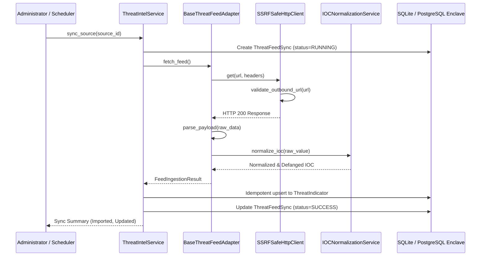

# THREAT SOURCE INTEGRATION GUIDE: MODULAR CONNECTOR ARCHITECTURE

**System:** CCIP (Citizen Cybercrime Intelligence Platform)  
**Classification:** RESTRICTED  
**Document Ref:** CTI-INT-001  

---

## 1. Overview & Connector Model

The Threat Intelligence Integration subsystem ingests threat data from approved open-source and commercial threat feeds using a unified, decoupled adapter interface (`BaseThreatFeedAdapter`). 

Each feed provider is registered in the database table `threat_intelligence_sources` and maps to a specialized adapter class:

| Provider Code | Feed Type | Adapter Class | Description |
| :--- | :--- | :--- | :--- |
| `STIX_TAXII` | `STIX_2` / `TAXII_2` | `StixTaxiiAdapter` | Ingests STIX 2.1 JSON Bundles, Indicator SDOs, and TAXII 2.1 collections. |
| `MISP` | `MISP_REST` | `MispAdapter` | Ingests MISP Event JSON, parsing Attribute elements, Galaxy matrices, and tags. |
| `ALIENVAULT_OTX`| `REST_API` | `AlienVaultOtxAdapter` | Ingests pulses and indicator arrays with actor attribution and TTP labels. |
| `URLHAUS` | `JSON_FEED` / `CSV` | `UrlhausAdapter` | Ingests real-time malware delivery URLs from abuse.ch telemetry. |
| `ABUSEIPDB` | `REST_API` | `AbuseIpdbAdapter` | Ingests IP blacklists, confidence scores, and country metadata. |
| `VIRUSTOTAL` | `REST_API` | `VirusTotalAdapter` | Ingests file/URL reputation analysis adhering to strict terms and rate limits. |

---

## 2. Secrets Management & Zero-Hardcoding Policy

In compliance with the Sovereign Enclave Security Mandate:
- **No API keys or bearer tokens are hardcoded in source code or database records.**
- The `credential_reference` column in `threat_intelligence_sources` stores only the **name of the environment variable** hosting the secret (e.g. `OTX_API_KEY`, `ABUSEIPDB_API_KEY`, `TAXII_AUTH_TOKEN`, `MISP_AUTH_KEY`).
- Secret values are resolved at runtime via `os.environ.get(self.credential_ref)`.
- If a credential reference is missing or its environment variable is undefined, public endpoints operate in unauthenticated read mode or raise a structured configuration error.

---

## 3. Resilience, Exponential Backoff & Rate Limiting

Network requests to external threat feed providers are managed by `fetch_feed()` with the following fault-tolerance mechanisms:

1. **Pre-Flight SSRF Protection:** Every destination URL is inspected by `validate_outbound_url` before opening a socket connection.
2. **Exponential Backoff:** If a network failure occurs, the adapter retries up to `max_retries` (default: 3) with exponential backoff:
   $$\text{Delay}_{\text{attempt}} = \text{initial\_delay} \times 2^{(\text{attempt} - 1)}$$
3. **HTTP 429 Handling:** When a provider issues an HTTP 429 Too Many Requests response, the adapter inspects the `Retry-After` header:
   ```python
   if resp.status_code == 429:
       retry_after = int(resp.headers.get("Retry-After", 5))
       result.retry_after_seconds = retry_after
       await asyncio.sleep(retry_after)
   ```
4. **Rate Limit Header Tracking:** Providers reporting `X-RateLimit-Remaining` have their remaining quota persisted in the `ThreatFeedSync.raw_summary_json` audit payload.
5. **Feed Health Monitoring:** Failed synchronization cycles increment `consecutive_failures` and record `last_failure_reason`. If a feed fails 5 consecutive times, administrators are alerted via internal notifications.

---

## 4. Ingestion Lifecycle Sequence



---

## 5. Adding New Providers

To add a new threat intelligence provider without modifying core pipelines:
1. Subclass `BaseThreatFeedAdapter` in `app/services/threat_feed_adapters.py`.
2. Implement `parse_payload(self, raw_data: Any) -> List[Dict[str, Any]]`.
3. Register the provider code in `ThreatIntelService.ADAPTER_MAP`.
4. Register the feed via `POST /api/v1/threat-intel/sources` or migration seeds.

