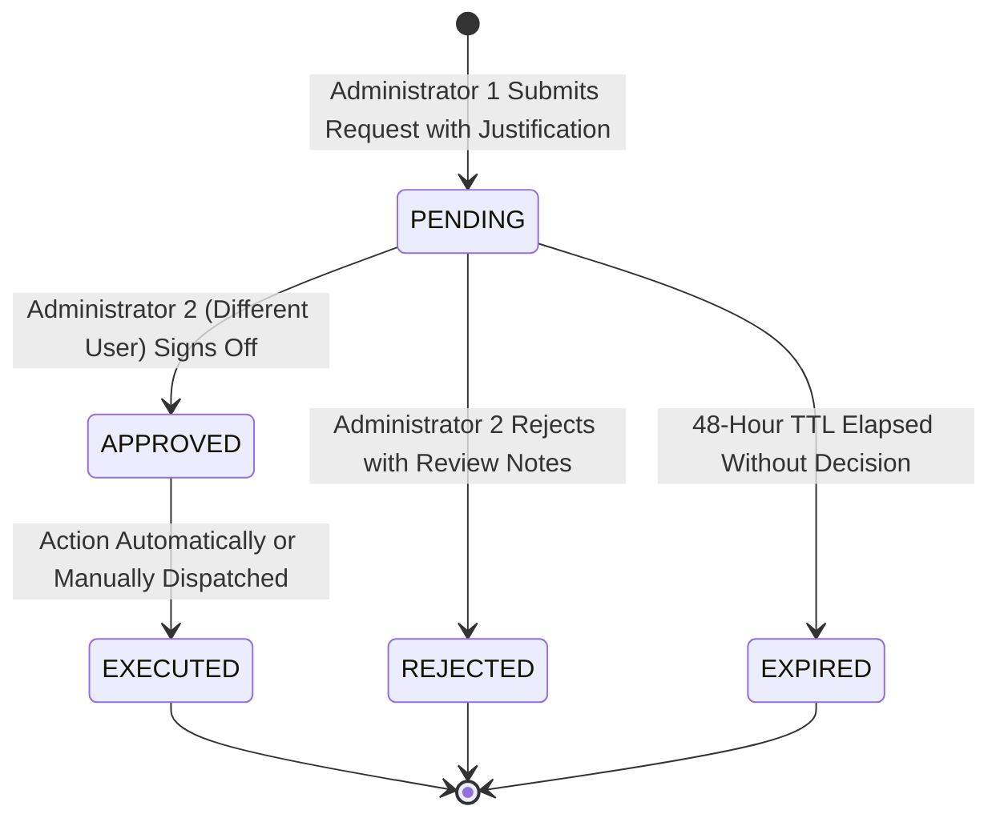

# ADMINISTRATIVE APPROVAL WORKFLOW SPECIFICATION
## Dual-Authorization Engine & Strict Separation of Duties
**Document Version:** 2026.2  
**Platform:** CCIP Sovereign Enclave  

---

## 1. Principles of Dual-Authorization (Two-Person Integrity)

In military and statutory intelligence architectures, critical operations must never depend on the unchecked authority of a single operator. CCIP implements **Separation of Duties** for high-risk administrative operations:

### Controlled Actions:
1. `BULK_USER_SUSPEND`: Mass suspension of officer or citizen accounts.
2. `SENSITIVE_EVIDENCE_EXPORT`: Decrypting and exporting raw evidentiary archives for external agencies.
3. `EVIDENCE_PURGE`: Physical deletion or purging of expired evidence files.
4. `AI_CONFIG_OVERRIDE`: Overriding threshold gates or disabling security verification models.
5. `KNOWLEDGE_SCOPE_CHANGE`: Elevating restricted internal SOP documents into public RAG retrieval.

---

## 2. Decision State Machine



### Strict Prohibition Against Self-Approval:
```python
# Enforced at API layer:
if approval.requested_by_id == current_user.id:
  raise HTTPException(
      status_code=403,
      detail=(
          "Dual-Authorization Violation: You cannot approve or sign-off on"
          " your own high-risk administrative action."
      ),
  )
```
Every request, rejection, and approval is immutably sealed in the audit log.
