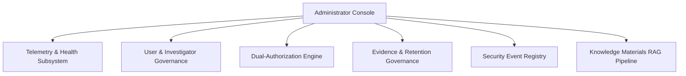

# ADMINISTRATOR GOVERNANCE WORKFLOW SPECIFICATION
## System Oversight, User Directory, Workload Allocation & Enclave Telemetry
**Document Version:** 2026.2  
**Platform:** CCIP Sovereign Enclave  

---

## 1. Governance Architecture

The CCIP Administrator Governance subsystem provides sovereign administrative control over enclave infrastructure, investigator rosters, role-permission matrices, database backups, and security events.

---

## 2. Investigator Profile & Capacity Management

Investigators are provisioned with:
- **Badge Number:** Unique institutional identifier.
- **Forensic Specializations:** E.g., `["FINANCIAL_FRAUD", "MALWARE_ANALYSIS", "RANSOMWARE", "CRYPTO_TRACING"]`.
- **Workload Ceiling:** Maximum concurrently assigned active cases (default: 15–20 cases).
- **Live Workload Tracking:** Dynamic calculation of open vs closed case metrics to prevent officer burnout and SLA breaches.
- **Clearance Level:** Enforces strict role-based access to sealed investigation dossiers.
