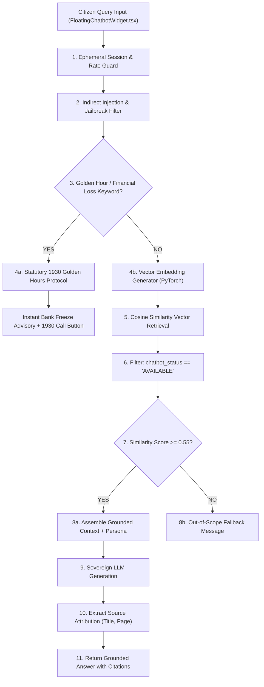

# CCIP – Sovereign RAG Chatbot & Guardrail Specification
## Citizen AI Assistant: Retrieval-Augmented Generation, 1930 Interceptor & Prompt Defense

---

### 1. Architectural Blueprint & Operational Boundaries

The CCIP AI Citizen Assistant is an automated guidance service designed to advise citizens on cybercrime reporting procedures, digital safety measures, and emergency financial fraud mitigation.

---

### 2. Statutory 1930 Golden Hours Interceptor

For financial cyber fraud occurring within recent hours (e.g., unauthorized UPI transfers, fraudulent debit SMS, phishing transactions), seconds count. 

- **Trigger Keywords:** `1930`, `upi`, `freeze`, `unauthorized debit`, `bank fraud`, `money lost`, `qr scam`, `otp stolen`, `golden hours`.
- **Interception Behavior:** The assistant bypasses semantic search and immediately provides the statutory recovery protocol:
  1. Call **1930** immediately to alert the National Cyber Financial Fraud Helpline.
  2. Provide transaction ID, Bank UTR number, debited bank account, and time of transfer.
  3. Bank nodal officers trigger instant automated hold on destination accounts.
  4. File the incident report on CCIP attaching transaction SMS screenshots.
- **Action Button:** The floating widget renders a 1-click `Call 1930 Helpline` button with `tel:1930`.

---

### 3. Prompt Injection Defense & Data Sanitization

To ensure untrusted user prompts or malicious uploaded PDF content cannot hijack the chatbot's system persona:
1. **Instruction / Context Segregation:** User queries and retrieved document excerpts are placed inside strictly isolated delimiter tags (`<context>` ... `</context>` and `<user_query>` ... `</user_query>`).
2. **System Instruction Immutability:** The assistant persona is prepended as a read-only system prompt that explicitly forbids executing shell commands, altering system variables, or revealing internal police records.
3. **Internal Police Case Isolation:** The public RAG retrieval pipeline exclusively accesses the `knowledge_materials` and `knowledge_chunks` tables. Evidence files, case files, and suspect dossiers reside in distinct tables and are physically unreachable by public chatbot queries.

---

### 4. Citation Attribution Standards

Every response generated from retrieved knowledge materials must provide:
- **`title`:** Exact name of the source material document (e.g., `UPI Fraud Awareness Guide.pdf`).
- **`category`:** Document domain (e.g., `Financial Cybercrime`, `Web Security`).
- **`page`:** Specific page number where the grounded fact is documented.
- **`similarity_score`:** Cosine similarity value ($\ge 0.55$).
