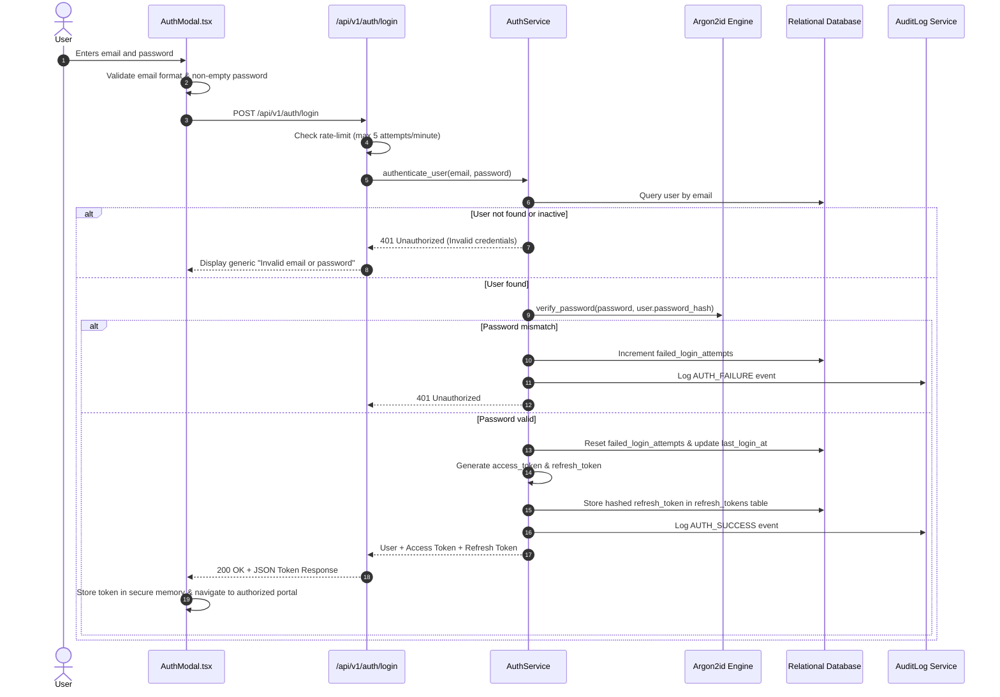

# CCIP – Authentication & Session Lifecycle Specification
## Complete End-to-End Authentication Architecture & Verification Guide

---

### 1. Authentication Mechanisms Overview

CCIP enforces a zero-trust multi-factor authentication architecture supporting:
1. **Citizen & Staff Password Authentication:** Argon2id memory-hard password verification ($m=65536\text{ KiB}, t=3, p=4$).
2. **One-Time Password (OTP) Verification:** 6-digit cryptographically random OTPs sent via Email or SMS, with 5-minute single-use validity and 60-second resend cooldowns.
3. **Google OAuth 2.0 Integration:** OpenID Connect authentication verifying `id_token` signatures, issuer (`accounts.google.com`), and audience.
4. **Session Token Lifecycle:**
   - Access Token: Short-lived (30 minutes), signed JWT containing user ID, role, and clearance tier.
   - Refresh Token: Long-lived (7 days), stored hashed with single-use rotation.
   - Ephemeral Public Chat Token: 24-hour TTL anonymous token bound to client IP hash.

---

### 2. Sign-In Workflow Sequence

---

### 3. Password Reset & Recovery Workflow

1. **Request:** Complainant or staff enters registered email on `ForgotPassword` view.
2. **Token Generation:** Backend generates a high-entropy 64-character URL-safe token, hashes it with SHA-256, and stores it in `password_reset_requests` with a 15-minute expiration timestamp.
3. **Delivery:** Reset link is dispatched to user's verified email.
4. **Consumption:** When user submits a new password:
   - Token validity and expiration are verified.
   - New password strength is evaluated ($>8$ chars, uppercase, lowercase, number, special char).
   - `password_hash` is updated using Argon2id.
   - Reset token is marked `is_consumed = True`.
   - All active refresh tokens for the user are revoked to force re-authentication across all devices.
   - Password change notification is audited.

---

### 4. Verification Checklist

- [x] Passwords hashed exclusively using Argon2id; zero plain-text passwords stored.
- [x] Failed login attempts tracked and rate-limited.
- [x] Single-use OTPs with 300-second expiration and 60-second cooldown.
- [x] Refresh tokens rotated upon consumption.
- [x] All authentication events (success, failure, password change) recorded in immutable audit log.

