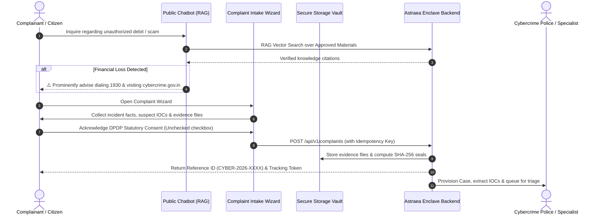

# CITIZEN PORTAL WORKFLOW SPECIFICATION
## AI-Powered Public Assistance & Incident Reporting
**Document Version:** 2026.2  
**Platform:** CCIP Sovereign Enclave  
**Clearance:** UNRESTRICTED CITIZEN & POLICE INTAKE  

---

## 1. Overview and Operational Philosophy

The Citizen Portal provides a secure, privacy-preserving, and accessible interface for individuals seeking guidance on suspected cybercrimes or formally submitting cyber incident reports. 

### Core Tenets:
1. **Anonymous Assistance vs. Formal Reporting:** Basic cyber safety guidance, triage advice, and helpline navigation (e.g. 1930 / I4C NCRP) are available unconditionally without requiring authentication or personal data collection.
2. **Statutory Distinction:** CCIP provides internal forensic triage, evidence integrity verification, and intelligence analysis. Guidance provided via AI or portal screens does not constitute a judicial police complaint unless escalated and accepted by an authorized law enforcement agency.
3. **Evidence Integrity:** Complainants retain full ownership of submitted evidence. Cryptographic SHA-256 hashes seal every document at the instant of intake.

---

## 2. Interaction Flow

---

## 3. Supported Incident Taxonomies

1. **Financial Fraud:** UPI / QR code payment scams, unauthorized net banking debits, credit/debit card fraud, OTP fraud.
2. **Identity & Social:** Impersonation, account takeover, illegal SIM swapping, deepfake defamation.
3. **Extortion & Harassment:** Sextortion, cyberstalking, illegal loan application harassment, ransomware.
4. **Phishing & Infrastructure:** Malicious APKs, fake banking websites, investment/crypto scams, lottery frauds.

---

## 4. Privacy & Data Protection Compliance

- **Data Minimization:** No biometric passwords, banking PINs, or card CVVs are ever solicited.
- **Client Anonymization:** Public assistance sessions use salted SHA-256 hashes of client IPs with 24-hour automatic expiration.
- **Enumeration Resistance:** Complaint reference numbers employ cryptographic entropy (`CYBER-2026-XXXXXX-XXXX`), preventing unauthorized status probing.
