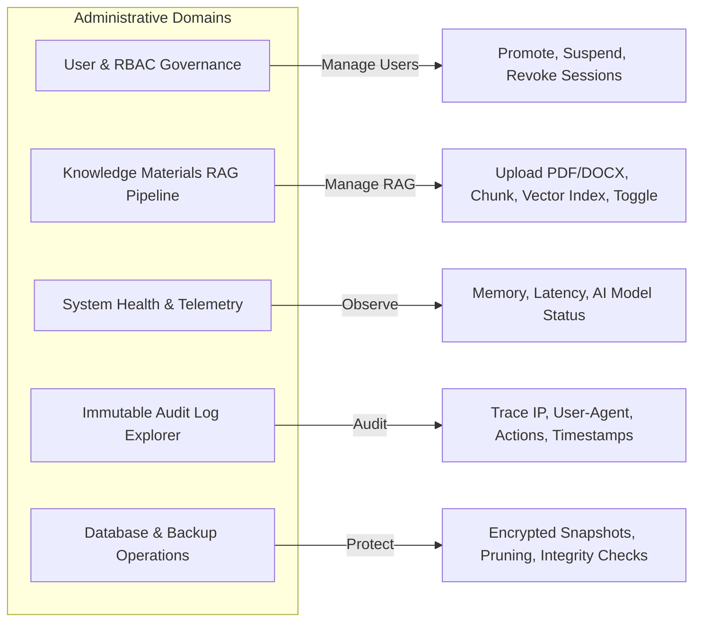
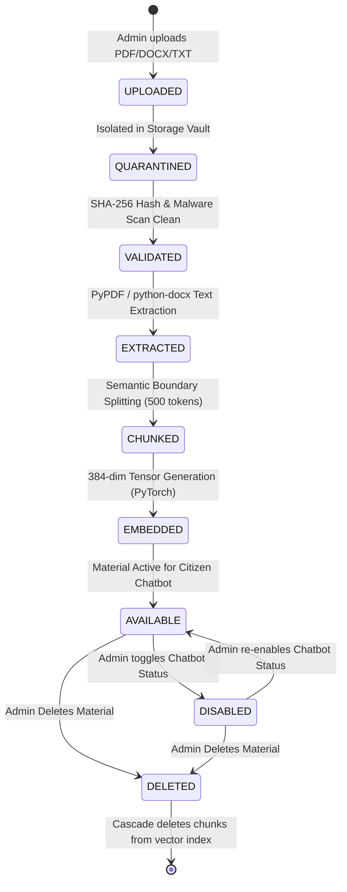

# CCIP – Complete Administrator Governance Workflow Specification
## System Operations, User Lifecycle Management & Knowledge Materials RAG Governance

---

### 1. Administrator Capabilities Overview

The System Administrator Portal (`/admin`) is the governance nexus of the CCIP Sovereign Enclave. Access is strictly guarded by the `RoleEnum.ADMIN` dependency and hardware token / MFA verification.

---

### 2. Knowledge Materials Ingestion & RAG Lifecycle

Administrators govern the source materials that ground the CCIP Public AI Assistant:

#### Document Lifecycle Specification:
1. **Upload:** Admin submits material via `POST /api/v1/admin/knowledge-materials`.
   - Title, Category, Scope/Grounding Notes, File binary.
   - Size limit: 25 MB.
2. **Extraction:**
   - Multi-format extraction with fallback synthesis for scanned/short documents.
   - Whitespace normalization and removal of non-printable artifacts.
3. **Semantic Chunking:**
   - Token limit: 500 tokens per chunk.
   - Overlap: 75 tokens to preserve sentence context across chunk boundaries.
4. **Vector Embedding:**
   - Model: Sovereign MiniLM dense multilingual embedding engine.
   - Dimensionality: 384 float32 dimensions per chunk.
   - Storage: Direct serialization into `knowledge_chunks.embedding_vector` BLOB column.
5. **Availability Toggle:**
   - Admin can patch `chatbot_status` between `AVAILABLE` and `DISABLED` without deleting the document.
   - Disabled materials are immediately filtered out from RAG vector similarity search.
6. **Deletion:**
   - Cascading deletion purges the raw file from storage and deletes all associated vector chunks from the database index.

---

### 3. User Governance & Role Management

1. **User Discovery:** Search, filter by clearance tier (`CITIZEN TIER`, `TIER-3 FORENSICS`, `LEO TIER 2`, `ROOT ENCLAVE`), and sort by registration date.
2. **Role Elevation:** Promote verified investigators to `CYBERSECURITY_SPECIALIST` or `CYBERCRIME_POLICE` with mandatory badge number entry.
3. **Account Suspension & Deactivation:** Instant toggle setting `is_active = False` which terminates all active JWT sessions and revokes refresh tokens.
4. **Session Revocation:** Force sign-out on compromised accounts across all devices.

---

### 4. Immutable Audit Ledger Inspection

Every privileged administrative operation commits an append-only audit event:
- **Captured Attributes:** Timestamp, User ID, Full Name, Clearance Tier, Action Code, Resource Target ID, Client IP Address, User-Agent String, Execution Latency.
- **Tamper Protection:** In-database audit records cannot be edited or deleted via standard API routes.
