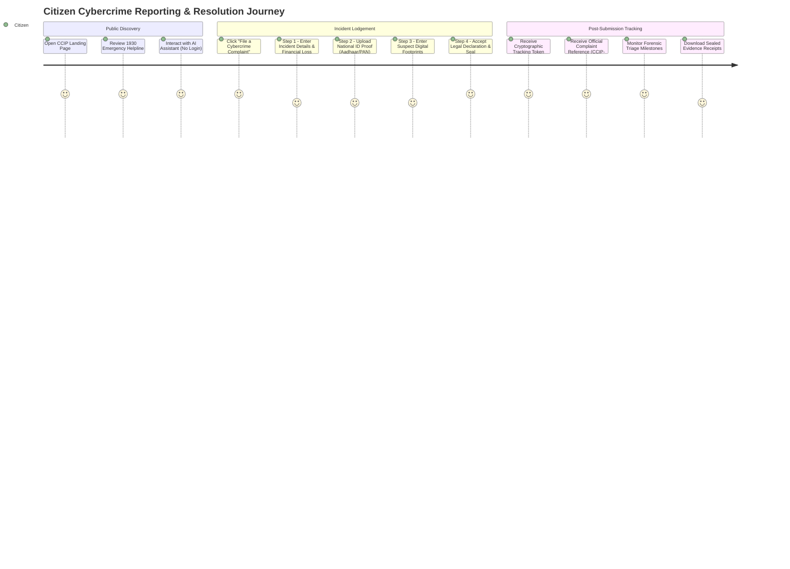

# CCIP – Complete Citizen User Workflow Specification
## End-to-End Citizen Journey: Incident Intake, Evidence Sealing & Investigation Tracking

---

### 1. Citizen User Journey Overview

---

### 2. 4-Step Guided Complaint Intake Wizard

#### Step 1: Incident Categorization & Financial Loss
- **Incident Category Selection:**
  - Financial Cyber Fraud (UPI, Net Banking, Credit/Debit Card)
  - Social Media Fraud & Impersonation
  - Identity Theft & Aadhaar Misuse
  - Phishing, Smishing & Fake Investment Apps
  - Cyber Stalking, Extortion & Sextortion
  - Digital Arrest & Law Enforcement Impersonation
- **Input Validation Rules:**
  - Incident Date/Time: Mandatory, cannot be set in the future.
  - Incident Narrative: Minimum 200 characters required to substantiate forensic intake.
  - Sanitization: Rejection or escaping of command-injection characters (`#$@^*~`!|`).
  - Loss Amount: Numeric formatting with real-time Indian Rupee (INR) representation.

#### Step 2: National ID Verification & Client-Side Sealing
- **Supported Identity Documents:** Aadhaar Card (masked), PAN Card, Voter ID, Passport, Driving License.
- **Client-Side SHA-256 Digest:** Prior to byte dispatch, the browser computes the cryptographic SHA-256 hash using `crypto.subtle.digest('SHA-256', arrayBuffer)` to guarantee that the uploaded bytes match the recipient enclave record.
- **File Validation:** Size capped at 5 MB; MIME types restricted to `.jpg`, `.jpeg`, `.png`, and `.pdf`.

#### Step 3: Suspect Digital Footprint Identification
- **Suspect Entity Fields:**
  - Suspect Bank Account Number / IFSC Code
  - UPI Identifier (e.g., `fraudster@ybl`, `scam@okaxis`)
  - Target Mobile Number / WhatsApp Handle
  - Fraudulent Website URL or APK Link
  - Cryptocurrency Wallet Address (BTC, ETH, USDT-TRC20)
- **Automatic Entity Normalization:** Extracts clean domain names, phone numbers with country codes (`+91`), and standardizes transaction UTR numbers for police dispatch.

#### Step 4: Legal Declaration & Enclave Sealing
- **Statutory Affirmation:** Digital confirmation under Section 66D of the Information Technology Act 2000.
- **Cryptographic Enclave Sealing:**
  - Enclave registers complaint into `complaints` table.
  - Generates a 64-character high-entropy `tracking_token`.
  - Automatically escalates urgent financial fraud complaints into the Golden Hour triage queue.
  - Issues official complaint reference code (e.g., `CCIP-2026-9842`).

---

### 3. Investigation Tracking & Real-Time Milestones

1. **Intake & Submission Integrity:** Verified SHA-256 seal stored into sovereign vault.
2. **AI Triage & Urgency Classification:** DeBERTa-v3 categorizes incident severity (`CRITICAL`, `HIGH`, `MEDIUM`, `LOW`).
3. **Specialist Assignment:** Automated dispatch to State Cyber Crime Cell or National 1930 Command nodal officer.
4. **Interim Police Action:** Freeze orders issued to recipient banks via National Cyber Financial Fraud (NCRP) integration.
5. **Final Judicial Resolution:** Investigation report sealed and issued for judicial proceeding.
