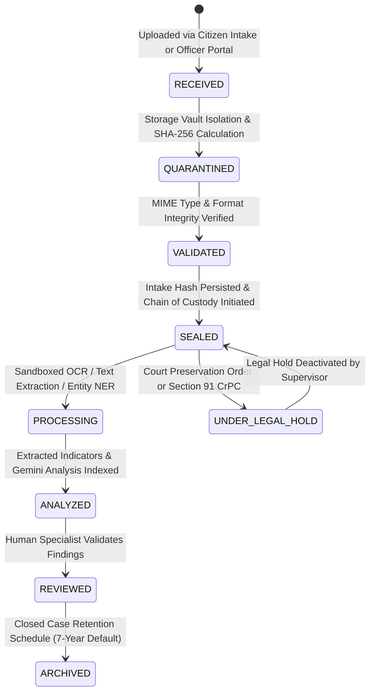

# DIGITAL FORENSIC EXAMINATION WORKFLOW
## Digital Evidence Intake, Sandboxing, Hash Verification & Chain of Custody
**Platform:** Cyber Crime Intelligence Platform (CCIP)  
**Security Clearance:** ENCLAVE RESTRICTED / FORENSIC TIER  
**Version:** 2.0.0  

---

## 1. Statutory Forensic Mandate

Digital evidence acquired during cybercrime investigations must comply with statutory admissibility standards pursuant to Section 65B of the Indian Evidence Act, 1872 / Section 63 of Bharatiya Sakshya Adhiniyam, 2023 (BSA). The CCIP Enclave guarantees:
1. **Zero Overwrite Principle:** Original citizen and investigator evidence files are sealed in read-only encrypted vault storage (`storage_vault/`).
2. **Cryptographic Checksums:** An immutable SHA-256 digest is generated immediately upon stream ingestion.
3. **Continuous Custody Auditing:** Every inspection, preview, download, or verification event is logged with officer identity, timestamp, and IP address.
4. **Sandboxed Processing:** Risky or untrusted binaries (`.exe`, `.apk`, `.bat`, `.ps1`) are quarantined and barred from native server execution.

---

## 2. Evidence Lifecycle State Machine



---

## 3. On-Demand Integrity Verification Protocol

When a forensic examiner or court commissioner requests verification:
1. The examiner issues `GET /api/v1/evidence/{evidence_id}/verify-hash`.
2. The backend opens the physical file stream in binary read mode (`rb`).
3. SHA-256 is computed using a streaming 64 KB buffer:
   ```python
   hasher = hashlib.sha256()
   with open(storage_key, "rb") as f:
       while chunk := f.read(65536):
           hasher.update(chunk)
   computed_hash = hasher.hexdigest()
   ```
4. If `computed_hash == evidence.sha256_hash`:
   - Verification event logged as `VERIFY_HASH` with status `VERIFIED_AUTHENTIC`.
5. If mismatch detected:
   - System flags `integrity_status = "TAMPER_ALERT"`.
   - Dispatches a `CRITICAL` alert to the `security_events_registry`.
   - File downloads are immediately blocked.

---

## 4. Legal Holds & Retention Policies

- **Default Retention:** 7 years for standard cybercrime records; 10 years for financial wire fraud; permanent preservation for national security incidents.
- **Legal Hold Enforcement:** When `legal_hold_flag = True`, automated statutory purge workers and administrative bulk deletion routines are strictly halted.

