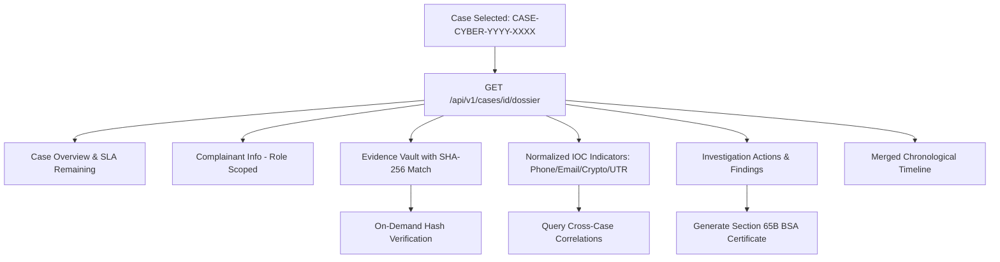

# INVESTIGATION WORKSPACE WORKFLOW
## Digital Forensic Analysis, Case Dossier & Intelligence Consolidation
**Platform:** Cyber Crime Intelligence Platform (CCIP)  
**Security Clearance:** ENCLAVE RESTRICTED / LAW ENFORCEMENT  
**Version:** 2.0.0  

---

## 1. Overview

The Unified Investigation Workspace provides an integrated operational console for investigating officers and digital forensic specialists. It centralizes case metadata, complainant narratives, digital evidence vaults, extracted IOC indicators, AI analysis suggestions, and peer-reviewed findings into a single, cohesive dossier.

---

## 2. Workspace Panes & Capabilities

### 2.1 Case Overview & SLA Timer
- **Case Reference:** High-entropy identifier (e.g. `CASE-CYBER-2026-9842`).
- **Priority & Risk Score:** Color-coded priority badges (CRITICAL: Red, HIGH: Amber, MEDIUM: Blue, LOW: Gray) with dynamic risk score (0–100).
- **Dynamic SLA Countdown:** Displays remaining time before statutory SLA breach (e.g. "18 hours 42 minutes remaining"), automatically flagged if breached.

### 2.2 Evidence Vault Pane
- **File Schedule:** Displays filename, MIME type, byte size, intake timestamp, and recorded SHA-256 hash.
- **On-Demand Recalculation:** Clicking "Verify Hash" triggers a real-time byte stream check against the enclave disk, updating status to `VERIFIED_AUTHENTIC` or dispatching a `TAMPER_ALERT`.
- **Legal Hold:** Authorized officers can activate a legal hold to prevent statutory retention routines from purging the artifact.

### 2.3 IOC Indicator Deck
- **Normalized IOCs:** Automatically parses and normalizes indicators:
  - Phone numbers formatted to international E.164 (`+91...`).
  - Emails and domains lowercased and stripped of protocol wrappers.
  - Crypto wallets validated against network address formats (Bitcoin Base58/Bech32, Ethereum Hex).
  - Bank UTR numbers formatted to standard alphanumeric uppercase.
- **Cross-Case Linkage:** Clicking an indicator runs an exact-match query against other operational cases in the platform.

### 2.4 Action Stream & Findings
- **Investigation Actions:** Record forensic pivots, suspect interviews, search warrant executions, and bank freeze notices.
- **Peer-Reviewed Findings:** Add structured forensic conclusions with confidence scores (0.00–1.00) and evidence references. Findings are marked `UNVALIDATED` until verified by a senior officer or supervisor.

### 2.5 Section 65B Digital Certificate Issuance
- With one click, the investigator can generate a court-admissible Section 65B Indian Evidence Act / Section 63 BSA certificate that bundles all case evidence with verifiable cryptographic hashes.

