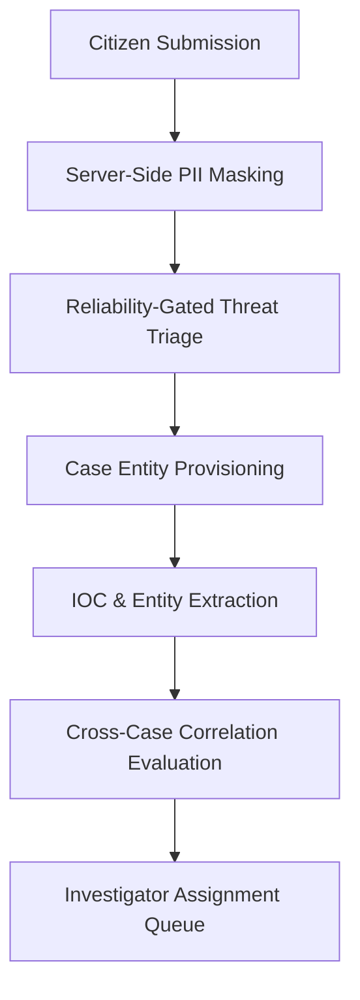

# INVESTIGATOR HANDOFF WORKFLOW SPECIFICATION
## Automated Triage, IOC Extraction & Case Provisioning
**Document Version:** 2026.2  
**Platform:** CCIP Sovereign Enclave  

---

## 1. Complaint-to-Case Transition Architecture

When a citizen submits a report through the intake wizard, the system automatically executes the **Investigator Handoff Protocol**:

### Steps Executed Synchronously & Asynchronously:
1. **Server-Side PII Masking (`pii_redactor.py`):** Redacts complainant Aadhaar numbers, PAN numbers, and private banking passwords before logging or delivering to secondary pipelines.
2. **Deterministic & AI Threat Triage (`threat_triage_service.py`):** Computes priority score (`CRITICAL`, `HIGH`, `MEDIUM`, `LOW`) based on financial loss, severity tags, and incident recency.
3. **Formal Case Docket Initialized:** Generates a corresponding `Case` record linked 1-to-1 with the complaint.
4. **Structured Cyber Entity Extraction (`entity_service.py`):** Automatically creates `CyberEntity` and `ReportIndicator` nodes for telephone numbers, email addresses, crypto wallets, and domains.
5. **Cross-Case Correlation Graph (`cross_case_correlation_service.py`):** Checks for co-occurring indicators across active cases to detect multi-victim cybercrime syndicates.
6. **Queue Placement:** The case appears immediately in the Police and Specialist review queues with priority sorting.
