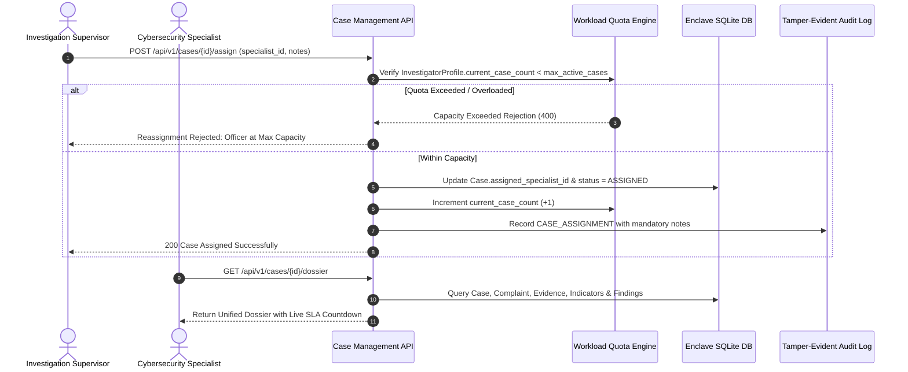

# LAW ENFORCEMENT & INVESTIGATOR PORTAL WORKFLOW
## Operational Procedures, Case Assignment & SLA Governance
**Platform:** Cyber Crime Intelligence Platform (CCIP)  
**Security Clearance:** ENCLAVE RESTRICTED / LAW ENFORCEMENT  
**Version:** 2.0.0  

---

## 1. Overview & Operational Mandate

The CCIP Law Enforcement & Investigator Portal provides a secure, role-restricted operational workspace for cybercrime investigators, forensic specialists, intelligence analysts, and unit supervisors. The system enforces strict 8-tier role separation, data minimization, and statutory chain-of-custody compliance.

---

## 2. 8-Tier Role-Based Access Control (RBAC)

1. **Citizen (`CITIZEN`):** Restricted to filing complaints, viewing general safety advisories, and tracking own complaint milestones via high-entropy tokens.
2. **Investigator (`INVESTIGATOR`):** Authorized to view assigned cases, record field actions, and review extracted IOCs.
3. **Senior Investigator (`SENIOR_INVESTIGATOR`):** Authorized for cross-case inquiry, recommendations for charge sheet filing, and closing cases with supervisor concurrence.
4. **Intelligence Analyst (`INTELLIGENCE_ANALYST`):** Authorized to query cross-case IOC correlation networks, threat feeds, and 3D WebGL intelligence graphs.
5. **Forensic Analyst (`FORENSIC_ANALYST`):** Authorized to perform on-demand SHA-256 byte recalculations, verify evidence hashes, and extract file metadata.
6. **Investigation Supervisor (`INVESTIGATION_SUPERVISOR`):** Authorized to assign/reassign cases, monitor unit SLAs, approve findings, and escalate cases to Command Dispatch.
7. **Administrator (`ADMIN`):** System operations, investigator profile management, dual-authorization requests, and system telemetry.
8. **Security Administrator (`SECURITY_ADMIN`):** Security events registry, failed authentication auditing, BOLA/IDOR attempt tracking, and enclave access policy enforcement.

---

## 3. SLA Deadlines & Priority Classification

The platform automatically computes SLA target resolution times from case creation:
- **Critical (24 Hours):** Active ransomware extortion, ongoing financial wire fraud, critical infrastructure attacks.
- **High (72 Hours):** Identity theft, unauthorized corporate data breaches, sextortion.
- **Medium (7 Days):** E-commerce fraud, phishing campaigns with moderate financial impact.
- **Low (14 Days):** Unsuccessful phishing attempts, unsolicited spam.

If a case exceeds its SLA duration, `is_sla_breached` is flagged as `true`, and high-visibility alert pills appear on supervisor dashboards.

---

## 4. Section 65B Indian Evidence Act / BSA Digital Certificates

The system provides on-demand generation of statutory electronic evidence certificates compliant with Section 65B of the Indian Evidence Act, 1872 / Section 63 of Bharatiya Sakshya Adhiniyam, 2023 (BSA):
1. **Officer Affirmation:** Records the certifying officer's name, email, badge number, and authorized role.
2. **Device & Environment Signature:** Captures enclave platform OS, Python version, node identifier, and storage vault directory.
3. **Schedule of Evidence:** Lists every digital artifact, file size, MIME type, acquisition timestamp, intake SHA-256 hash, and current verified physical hash.
4. **Integrity Status:** Evaluates bit-for-bit match (`AUTHENTICATED_AND_VERIFIED` or `INTEGRITY_TAMPER_ALERT`).
5. **Cryptographic Seal:** Generates a SHA-256 digest over the canonical JSON certificate payload.
